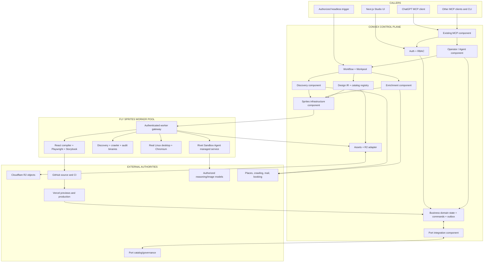
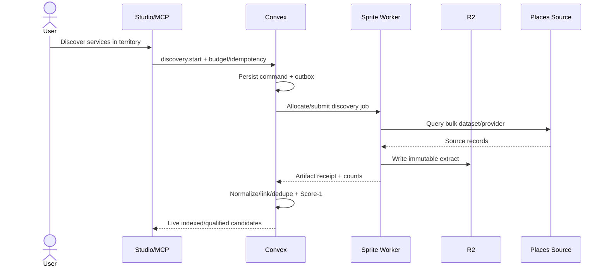
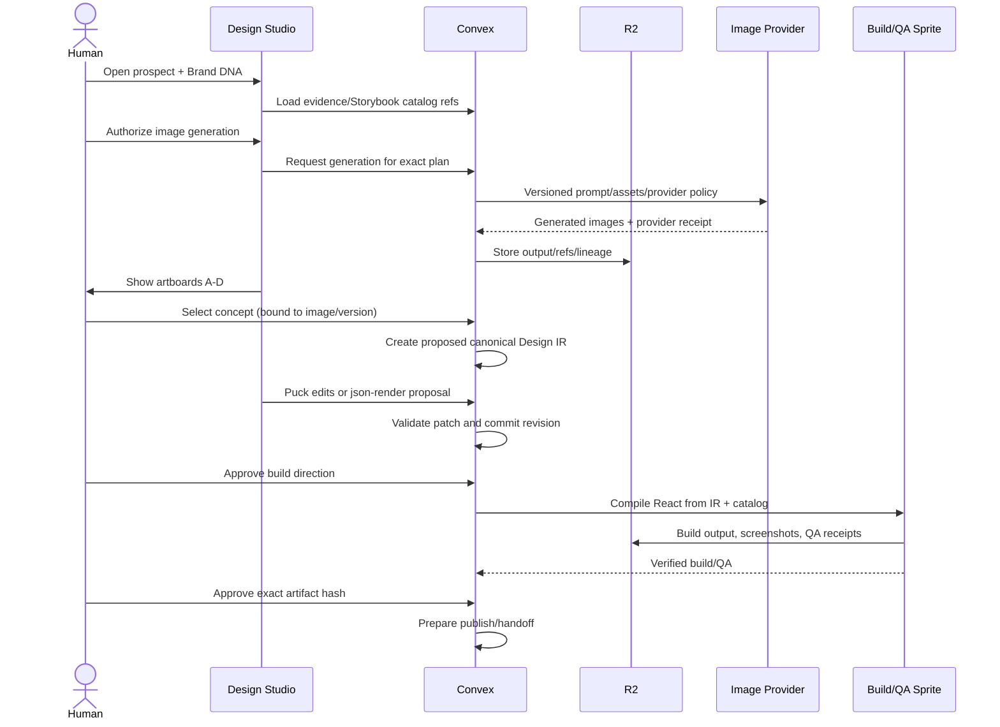
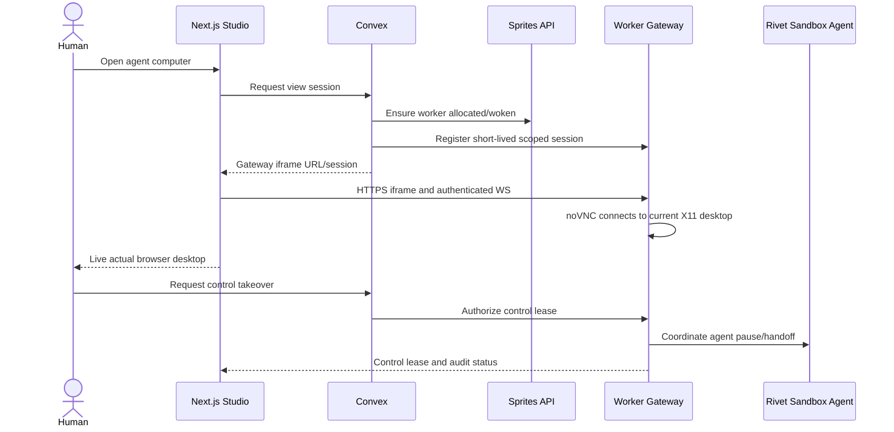

# PROSPECT STUDIO — COMPLETE MASTER SYSTEM SPECIFICATION

**Revision:** PS-MASTER-3.1 · **As of:** 2026-11-09 · **Sorted:** goldfish Wave 1 blockers B2/B3/B4/B11/B12/B13 + P0 base locked · **Document type:** build contract + architecture map + component registry + acceptance plan  
**Canonical repository:** `mplsjohnnycage/prospect-studio` (`main`, private; source inspected 2026-11-09)  
**Target:** Extend the *existing* application, not a replacement CRM, a new Convex project, or a fresh disconnected frontend.  
**Status legend:** **V** = confirmed in inspected repo/source or prior live Sprite inspection; **D** = directly established design requirement; **P** = engineering proposal for implementation; **R** = researched candidate / needs benchmark; **U** = not yet verified. A package in `package.json` is **installed in source**, not necessarily operational in production.

> **Document priority:** This specification is the authoritative record for architecture, scope and acceptance. Where it conflicts with an earlier design, the decision recorded here wins. The decisions that produced it (dated 2026-11-09) are listed in Appendix A — Decision log; a decision not in that log is not binding. Locked architecture: Convex owns durable *business* workflow transitions; Rivet owns execution/agent sessions; Port may originate catalog/governance *requests* but does not own Loop-1 approvals; Sprites replace E2B as the sandbox computer; one outward MCP tool surface uses Convex's existing component; Storybook, Puck, json-render, ImageGen and R2 are core design-to-production subsystems. Older Rivet-as-sole-workflow-owner, Turso-as-primary-event-store, and alternative hosting plans are migration questions—not current deployment choices.

## 0. Executive definition and inviolable product constraints

**Product:** A map-first, AI-operated, evidence-based local-business prospecting, brand intelligence, custom-site design, demo, supervised outreach and production-handoff platform. The operator is *statelessly stateful*: inference can be invoked per request while identity, conversations, permissions, memory references, commands and pipeline state persist in Convex. It is callable from the web UI, ChatGPT, any authorized MCP client, and headless automation. Heavy work is performed by existing or provisioned Fly Sprites, with Rivet Sandbox Agent for agent sessions.

**Business flow:** `Discover → Qualify → Extract → Design → Demo → Outreach → Convert → Produce`. The **first implementation acceptance loop** is more granular: `Source → Normalize/Dedupe → Score-1 → Select/Enrich → Score-2 → Qualify → Authorize Generation → Visual Concept → Concept Approval → Design IR → Build/QA → Exact-Artifact Approval → Handoff`. Outreach and production are later gated branches. Do not confuse the UI's eight labels with individual technical tasks.


### 0.1 Problem, hypothesis, goals, non-goals and success criteria

**Problem (P; to verify against operating baseline).** Local-service-business prospecting in the Twin Cities currently requires multiple disconnected steps: locating eligible businesses; reconciling duplicate identities; confirming websites, service areas, contacts and brand evidence; deciding whether a business needs a better website; and producing a credible, prospect-specific demonstration. Without one evidence-backed system, the operator repeats research, cannot audit geographic/source coverage or score provenance consistently, and can mistake a generated visual concept or agent success message for a real working site. **The magnitude of current manual time, conversion rates and opportunity cost has not yet been measured.** Capture this baseline before claiming savings.

**Affected users (D/P).** Primary: the human founder/operator who selects prospects and approves generative work, external outreach and deployments. Secondary: authorized researcher/design agents, and eventually collaborators operating with scoped tenant permissions. Businesses receiving demos are external recipients, not automatically authorized Studio users.

**Loop-1 hypothesis (P).** Reusing bulk Overture/DuckDB ingestion, source-aware identity resolution, staged website enrichment, transparent score rules, an evidence-conditioned component catalog/ImageGen pipeline and immutable approval/QA receipts will reduce operator labor per qualified, working demo compared with the existing manual baseline, without increasing inaccurate prospect claims or unauthorized external actions. This is a **testable hypothesis**, not a verified business result.

**Loop-1 product goals (D).**
1. Produce a repeatable Twin Cities source-to-qualified-prospect process with geographic, source and duplicate coverage reporting.
2. Create one real, prospect-specific, working interactive demo after the applicable generation/selection gates, with independently tested lead-form persistence and source-backed design content.
3. Preserve exact evidence, score versions, generated assets, Storybook catalog references, Design IR revisions, build hashes, approval decisions and provider receipts.
4. Let UI and authenticated MCP/headless clients inspect the same state and submit the same authorized commands.
5. Demonstrate failure recovery, human-gate enforcement, correct tenant isolation and no unsupported model/subscription billing assumptions.

**Loop-1 non-goals (D/P; scope boundaries, not deleted system requirements).**
- No automatic outbound marketing, send, contract execution, payment capture, production-domain cutover or unlimited background agent swarm in the first handoff acceptance loop; their interfaces remain planned and separately authorized.
- No obligation to install or benchmark all researched lead-source providers; ship an Overture/DuckDB baseline and compare additional adapters before production adoption.
- No requirement that the shared noVNC agent desktop, full Port governed write integration or a second production code emitter be complete to prove the first prospect handoff. They **remain required target capabilities** with separately defined milestones; dependencies cannot be silently dropped.
- No replacement of the existing Prospect Studio map-first application, no new competing CRM, no duplicate source-of-truth database, and no wholesale migration of existing Convex native files to R2.
- No claim that generated mockups equal deployed sites, or that a consumer ChatGPT subscription grants unrestricted unattended model/API use.

**Acceptance criteria and proposed numeric thresholds (P unless marked D).** These are **test gates to validate**, not claims of achieved performance and not authorization to incur spend.

| ID | Criterion | Measurement / proposed initial target | Gate |
|---|---|---|---|
| G-01 | Real bulk ingestion | At least **1,000** source-grounded, eligible Twin Cities candidate records in one reproducible release-scoped test run; report release, category/territory coverage and raw vs canonical counts | Discovery pilot |
| G-02 | Import reproducibility | Re-running the exact release/input produces **0** additional duplicate canonical identities, with source links preserved | Discovery pilot |
| G-03 | Provenance completeness | **100%** of sampled promoted facts and every eligibility/score claim reference a source and observation time, or are explicitly marked unknown/inferred | Discovery pilot |
| G-04 | Identity correctness | Human adjudication of **100** stratified record matches/possible merges; **0 false merges accepted** in sample. Report precision and uncertain cases; do not extrapolate an unmeasured population false-negative rate | Discovery pilot |
| G-05 | Score completeness | **100%** of ingested eligible places have Score-1 or explicit failure; **100%** of selected deep-audit candidates have Score-2 or an explicit blocked/unknown state and rule-version receipt | Qualification |
| G-06 | Website truth | Manually review at least **30** no-site/unreachable classifications; track false no-site claims separately, with **0 unsupported confirmed-no-site assertions** allowed into approved demos | Qualification |
| G-07 | Reproducible handoff | **At least 1** real business completes source → enrichment → qualification → concept authorization → design → functional build/QA → exact-artifact approval → verified handoff; all stages leave receipts | End-to-end smoke |
| G-08 | Functional demo | **100%** of released interactive demo forms create a validated, tenant/site-scoped test submission that survives restart/reload; rate limiting, consent and data-retention policy exercised | Build/QA |
| G-09 | Authorization safety (D) | **0** unapproved concept-generation actions, public publishes, outbound sends, or production promotions under positive and adversarial tests | Every gated release |
| G-10 | Artifact integrity (D) | **100%** of approved/published demo revisions have matching canonical content hash, build manifest and passing functional/visual QA receipt; stale/hash-modified versions rejected | Build/QA |
| G-11 | Cross-client consistency | One representative task initiated by UI and another by independent MCP client yield the same typed command/status/receipt model with correct authorization; no client-specific shadow pipeline | Integration |
| G-12 | Recovery and isolation | Duplicate commands, lost callbacks, worker restart, stale approvals, cross-tenant access and webhook replay all pass negative tests before release; **0** duplicated irreversible effects | Reliability |
| G-13 | Measured unit economics | Measure actual discovery/enrichment cost per **1,000** candidates, cost per qualified prospect and cost per approved handoff; enforce a configured spend cap and record budget reservations/receipts | Pilot and scale |
| G-14 | Productivity improvement | Record manual baseline on **10** comparable prospect tasks if available; target at least **50% reduction** in median operator hands-on time for first **10** completed assisted handoffs, excluding human approval waiting time (provisional; revise from pilot) | Post-smoke validation |

**Commercial design points requiring owner approval before scale (OPEN, owner: product operator):**
- Qualified prospects per week and minimum acceptable precision/recall under realistic sampling.
- Maximum total cost per qualified prospect, per approved interactive handoff and per unit of geographic coverage. The system SHALL collect actual costs before these ceilings are signed off; no guessed dollar amount is an authorization.
- Acceptable calendar elapsed time, human review effort, and conversion/handoff quality relative to baseline.
- Whether first production milestone must include the desktop/Port integrations before pilot handoff. They remain in the final architecture regardless of milestone ordering.

**Measurement protocol (P).** Every run must record timestamp, territory polygon/release, filter and provider versions, source record counts, duplicate/match decisions, audit selection criteria, sample seed, accuracy adjudication, actual resource/API/model usage and paid cost, approval latency, failures and artifacts. Sample verification findings must keep links to the underlying records. Report confidence and known blind spots. A single passing smoke test demonstrates basic integration, **not** market-scale reliability or commercial product–market fit.

**Hard rules (D):**
1. Reuse working code, components, SDKs and open source; build only missing integration glue and product-specific policy.
2. Convex is the only authority to commit canonical business-stage transitions. No duplicate, competing Port/Rivet/Turso/agent state machine.
3. One canonical business identity, one inbox/message record, one approved design revision, one provable send/deploy receipt.
4. Sprites are the computer provider; **no E2B dependency** and no requirement for Docker-in-Sprite/KVM.
5. The same typed domain commands power UI, MCP and headless integrations. An MCP client is not automatically authorized to perform irreversible actions.
6. ChatGPT subscription use must respect actual interactive-product and API entitlements; it is not a general unlimited background-inference API.
7. Retain original evidence, accurate provenance, source/asset rights, unknown-vs-none semantics, audit trails and reproducible scores.
8. Unapproved AI demos, outbound messages, live publication and consequential spend cannot pass their applicable gates. Separate concept-generation permission, concept selection, exact-artifact approval, publish approval, send approval and production authorization.
9. Every authoritative completion means a real, independently verified result and durable receipt—not an LLM report or cosmetic progress animation.
10. Keep the existing Vercel UI and current production/dev Convex deployments; avoid a second CRM, shadow prospect pool, or new throwaway deployment.
11. Preserve the map-first locked UX (dark, restrained, glass overlays, logo-first pins; full Design Studio is the exception that replaces the map).
12. Work is bounded, checkpointed, budgeted, resumable and idempotent; sleep/scale-to-zero while waiting for approval.

## 1. Read-verified baseline versus build target

### 1.1 Confirmed repository facts (V, GitHub default `main` inspected Nov 9)

- Repo: `mplsjohnnycage/prospect-studio`, private, default branch `main`.
- `package.json`: Next.js `16.4.3`, React `19.3.0`, Convex `^1.49.0`, TypeScript, Tailwind 4, shadcn, MapLibre, Playwright, Fly Sprites SDK `@fly/sprites` `^0.2.4`, `sandbox-agent` `^0.5.5`, Rivet packages, `@vercel/sandbox`, `@google/stitch-sdk`, `@google/stitch`, Firecrawl, AgentMail.
- `convex/convex.config.ts`: mounted `betterAuth`, `agent`, `rateLimiter`, `aggregate` as `prospectCounts`, `actionCache`, `geospatial`, `firecrawl`, `agentmail`, `workpool` as `researchPool`, and `mcp`.
- `convex/mcp.ts`: working *source implementation* of MCP tool registry wrapping `AGENT_TOOLS`, read/write scopes, user identity and API-key/connection utilities. Code explicitly withholds send/approval tools.
- `src/lib/domain.ts`: UI display stages `Discover, Qualify, Extract, Design, Demo, Outreach, Convert, Produce`, `canTransition`, `advance`, concepts A–D (Editorial, Local First, Conversion, Signature). Retained only as a display projection; the canonical persisted enum and migration are defined in §15.2.
- `convex/schema.ts` already defines `prospects`, `concepts`, `outreach`, `replies`, `replyDrafts`, `bookings`, `campaigns`, `suppressions`, `commands`, `actorEvents`, `activities`, `assistantMessages`, `proposals`, `followups` and other tables. **Extend/migrate, don't recreate blindly.**
- Storybook, Puck, and json-render are **not listed** in default-branch `package.json`. `@convex-dev/workflow@0.4.10` and `@convex-dev/r2@0.10.4` are adopted on branch `fix/phase0-prospect-reconcile-20261107` (SHA `21c4e8b`, based on production-matching `main` `db3056d`) and verified against Convex dev `gregarious-ibis-329`. They are **not yet merged to `main`**. Do not treat the stale hardening worktree or `rivet-spike-attach` dirty tree as the integration source.

### 1.2 Prior live infrastructure (V from previous Sprite tool inspection; recheck before writes)

| Resource | Known identifier / path | Meaning |
|---|---|---|
| Sprites org | `johnny-cage-831` | Execution account |
| Main Sprite | `prospect-studio` | Existing application/Rivet/desktop services |
| Main Sprite checkout | `/home/sprite/prospect-studio` | Had local branch `rivet-spike-attach` and uncommitted modifications |
| Other Sprite | `prospect-pipeline` | Existing resource, do not overwrite |
| Other Sprite | `agent-computer` | Experimental desktop/agent computer |
| Convex prod | `rightful-elk-426` | Preserve as canonical production target |
| Convex dev | `gregarious-ibis-329` | Preserve as canonical development target |
| App host | Existing Vercel Prospect Studio project | Verify live alias/current branch before release |

**Critical discrepancy:** Default `main` on GitHub and Sprite worktree have shown different package/build state. The implementation must compare HEADs, reconcile PR #35 and dirty changes, and use a clean worktree—not overwrite one with the other.

### 1.3 Design sources and provenance

- `prospect_studio_screen_and_component_spec_v2.md` (2026-10-15): locked screen/visual contract, 25 named screens S00–S24, reusable components C01–C24, strict LOCKED/REFERENCE/PROPOSED/OPEN labels.
- `TECHNICAL_SPEC_v3.md` (2026-10-31): typed command/event model, security, Hono/SQLite/Rivet alternative, four concepts, tests. A **proposal**, not proof of deployment.
- `prospect-studio-executable-spec-2026-11-07.md`: Overture-first Loop 1, provider bake-off, scored pool, R2 evidence, human gate, exact acceptance tests.
- `Conversation Git — Prospect Studio Discovery and Scoring Architecture.md`: preserves evolution, alternatives, conflicts, Port blueprints, AST, Puck/json-render, component catalog, visual QA.
- 2026-11-09 direct decisions: Sprites-backed Convex component replacing E2B; Rivet Sandbox Agent server as Sprite managed service; real shared desktop/browser; Convex-owned workflow; headless MCP interface; statelessly stateful operator; componentized discovery/enrichment/Port; R2, ImageGen, Puck, json-render, Storybook as core design subsystems.

## 2. Architecture maps — control, execution, data, design

### 2.1 System topology



### 2.2 Authority and data-motion rules

- **User commands:** Client → authenticated Convex tool/function → guard/command transaction → Workpool/Workflow → Sprite/provider → evidence/receipt → Convex authorized transition → reactive UI.
- **External events:** signed provider webhook → raw event record/dedupe → reducer → state or reconciliation command. Never let webhook arrival imply success absent verification.
- **Large objects:** worker/provider → short-lived upload URL/R2 → content hash and metadata → Convex reference. Never inline full crawls/images into Convex documents.
- **Catalog:** GitHub component source → Storybook real renders → R2 images → Convex registry; Port receives governance references only.
- **Deployment:** Design IR revision → build Sprite → QA → approval → Vercel deploy → verified health → Convex receipt and Port projection.

### 2.3 Data ownership / no dual-write

| System | Authoritative for | Non-authoritative projections |
|---|---|---|
| Convex host app | Canonical business identity, prospect stages, the sole approvals decision record, operator/commands, design revisions, publish/send decisions, worker registry (host tables; CX13 exposes operations over them) | Provider health, Port IDs, live worker status |
| Convex components | Their private implementation queues and provider state, in their own schema | Application-level run and prospect state; the worker registry is not component-owned |
| R2 | Exact object bytes and object version key | Business meaning and authorization |
| Sprite filesystem | Runtime files and installed services | Long-lived business facts |
| Rivet Sandbox Agent | Live agent session events/driver status | Commercial stage state |
| Port | Governed catalog entities/policies; may originate approval **requests**. **Status: U — deferred for Loop 1.** Convex is the catalog and governance record until a second, named consumer is demonstrated. | Canonical stage transitions; the approvals decision record |
| GitHub | Committed source revision | In-progress job status |
| Vercel | Deployment state/actual served site | Approval to publish |
| Supermemory | Long-term chat/project continuity | Transactional source of truth |
| Turso (if retained) | Append-only actor diagnostics or actor-local application data under explicit contract | Canonical business transitions |

## 3. Exact deployment locations and runtimes

| Concern | Runs where | Files/config to create or map | Network path |
|---|---|---|---|
| Main UI/map/Design Studio | Vercel Next.js app | `src/app`, `src/components` | HTTPS to Convex |
| UI component library | Repo package, loaded by Next.js and Storybook | proposed `packages/ui` | Build artifact, not backend |
| Storybook | Developer Sprite/CI; optional Vercel preview | `apps/storybook` or `.storybook` | Dev/review URL, not publicly writable |
| Puck | Next.js client Design Studio | `src/components/design/puck-*` | Calls typed Convex design mutations |
| json-render | Agent UI renderer and server-side validation adapters | `packages/json-render-adapter` | Validated Design IR only |
| Convex MCP | Existing Convex deployment | `convex/mcp.ts`, `convex/http.ts` | `/mcp`, auth-scoped |
| Operator memory/chat | Convex `@convex-dev/agent` + host state | `convex/operator/*` | MCP/UI functions |
| Workflow/outbox | Convex | `convex/workflows`, `convex/commands`, `convex/schema.ts` | Internal functions/actions |
| Sprites SDK component | Convex component + actions | `components/sprites` (P) | Sprites REST/SDK |
| Discovery/enrichment adapters | Convex actions + Sprite workers | `components/discovery`, `components/enrichment` | Worker HTTPS and callback |
| Port adapter | Convex component | `components/port` | Port API + signed webhooks |
| R2 service | Convex component/actions | `components/storage`, `convex/assets` | S3-compatible R2 endpoints |
| Provider/model routing | Authorized runtime/service | `convex/models` or agent client adapter | Provider-defined API/auth |
| Worker gateway | Sprite managed service | `/opt/prospect-worker/gateway` (proposed) | Sprite public HTTPS entry; auth required |
| Rivet Sandbox Agent | Sprite managed service | `/opt/prospect-worker/agents` | Private loopback behind gateway |
| Desktop + Chromium + noVNC | Sprite managed services | `/opt/prospect-worker/desktop` | Auth gateway + WebSocket |
| DuckDB/crawl/site audit | Native Sprite tools | `/opt/prospect-worker/tools` | External data providers |
| Build, Playwright, visual QA | Build/desktop Sprite | `/opt/prospect-worker/build` | Preview + artifact store |
| Object bytes | Cloudflare R2 | versioned object keys | Signed upload/read, CDN only for approved public assets |
| Source and CI | GitHub | Existing repo + verified workflows | CI → Vercel |
| Governance registry | Port | Blueprints/actions/webhooks | Port ↔ Convex typed API |

**No cloud billing/account/network details, domains or secrets are to be invented.** Obtain from current deployment settings during implementation.

## 4. Convex component map — installed, to add, and deliberately not separate

### 4.1 Existing mounted components (V in `convex/convex.config.ts`)

| ID | Package | Shared capability | App-owned work still required |
|---|---|---|---|
| CX01 | `@convex-dev/better-auth` | Authentication integration | Role/policy checks, client/tenant mapping |
| CX02 | `@convex-dev/agent` | Thread/message/tool infrastructure | Operator behavior, authorized skills and memory references |
| CX03 | `@convex-dev/rate-limiter` | Rate budgets | Per-provider/per-tenant limits and receipts |
| CX04 | `@convex-dev/aggregate` | Incremental aggregates | Business and cost metric definitions |
| CX05 | `@convex-dev/action-cache` | Cache for eligible actions | Cache key, freshness, rights/retention policy |
| CX06 | `@convex-dev/geospatial` | Geospatial lookup | Territory coverage, provenance, clustering APIs |
| CX07 | `@firecrawl/firecrawl-convex` | Firecrawl integration | Extraction provider adapter and eligibility controls |
| CX08 | `@agentmail/convex` | Mail integration | Draft/suppression/send gates, receipts |
| CX09 | `@convex-dev/workpool` | Controlled concurrency | Stage queues, budgets, recovery/dead-letter policies |
| CX10 | `@convex-dev/mcp` | Remote MCP server and auth | Scoped tool registry, trusted client mapping |

### 4.2 Required new or branch-verified capabilities

| ID | Capability | Target form | Public operations and ownership |
|---|---|---|---|
| CX11 | Convex Workflow | Existing community package, verify/install | Durable stage orchestration, typed run refs |
| CX12 | R2 object storage | Existing community package, verify/install | Sign upload, metadata, versioned keys and access control |
| CX13 | Sprites | Private reusable Convex component | `allocate`, `get`, `exec`, `files`, `services`, `checkpoint`, `release` |
| CX14 | Discovery | Private reusable Convex component | `discover`, `status`, `cancel`, `import`, source adapters |
| CX15 | Enrichment | Private reusable Convex component | `enrich`, `audit`, `verify`, `status`, provider adapters |
| CX16 | Port | Private reusable Convex component | `getEntity`, `register`, `requestAction`, `ingestWebhook` |
| CX17 | ImageGen | Adapter/possibly component after feasibility check | `generateConcept`, `generateAsset`, `getReceipt` |
| CX18 | Asset registry | Host app + optional reusable asset package | `register`, `getSignedUrl`, `lineage`, `revoke`, `publish` |
| CX19 | Design/catalog | Host app domain with reusable package | Versioned Design IR/catalog refs/patches/revisions |
| CX20 | Render/evaluate | Host app actions + Sprite worker | `render`, `visualEvaluate`, `runQA`, `repair` |
| CX21 | Deployment | Host app provider adapter | `build`, `preview`, `deploy`, `verify`, `rollback` |
| CX22 | Communications | Host app, existing AgentMail | Draft, gate, send, reconcile, reply/booking |

### 4.3 Other evaluated components, not compulsory installs

`resend`, `suppression-list`, `static-hosting`, `migrations`, `action-retrier`, `sharded-counter`, `persistent-text-streaming`, `webhook-receiver/sender`, `AI-budget`, `LLM-cache`, `evalbench`, `Langfuse`, `tracer`, `Polar`, `stagehand`, `nano-banana` integrations. Each receives an adoption decision only after checking license, maintenance, version, duplicate functionality and measured benefit. **Do not create a Convex component for Puck, Storybook or json-render simply because they are useful; these are design/runtime packages with a shared backend contract.**

## 5. Sprite computer runtime, profiles, service graph and provisioning

### 5.1 Provisioning contract (CX13)

**Inputs:** `tenantId`, `profileId`, `profileVersion`, `capabilities[]`, `jobId`, `resourceClass`, `ttlPolicy`, `networkPolicy`, `idempotencyKey`. **Outputs:** `workerId`, `spriteId`, `url`, `profileHash`, `capabilities`, `readiness`, `leaseId`, `checkpointRef?`. Component owns infra registry; host app owns the business job.

1. Look for an idle healthy matching Sprite with exact compatible profile version and policy; acquire an atomic allocation lease.
2. If none exists and capacity/budget allow, call the **actual** supported `@fly/sprites` API to create a Sprite; never pretend `image:`/`template:` is a documented argument unless verified.
3. Bootstrap from a Git-pinned manifest or apply a verified compatible checkpoint on the **same** Sprite; install only missing binaries/dependencies.
4. Register the managed gateway/agent/desktop services; verify each health check, schema and version.
5. Return only a scoped authenticated endpoint/session, never admin credentials to the browser or agent prompt.
6. Run job, stream progress/receipts; on completion checkpoint artifacts, release lease, allow Sprite to sleep.
7. Reconcile stale leases, crashed services, orphan resources and unknown remote operations.

**Workspaces (P):** `/opt/prospect-worker/{gateway,tools,agents,desktop,build}`, `/home/sprite/workspaces/<tenant-hash>/<run-id>`, local caches under `/var/cache/prospect-worker`, service manifests committed in repo. These are proposed paths, not existing directory assertions.

### 5.2 Worker profiles and exact baked-in capabilities

| Profile | Native install | Must expose | Should NOT contain |
|---|---|---|---|
| `base-v1` | Node, Python, Git, CA certificates, lightweight HTTP service, upload client, health/telemetry | `/health`, `/capabilities`, `/jobs`, `/jobs/{id}` | Provider passwords in image |
| `discovery-v1` | DuckDB, `httpfs`, spatial extension, Parquet/JSONL tools; selected places adapters | `discover.places`, `normalize.batch`, `export.extract` | Full GUI unless source requires it |
| `enrichment-v1` | httpx (website probing), selected crawl parsers, Firecrawl adapter, Crawl4AI/Scrapling if validated, SiteOne binary if validated | `audit.website`, `extract.brand`, `verify.contact` | Unbounded per-business deep crawl |
| `browser-v1` | Chromium, Playwright, Stagehand/agent-browser if supported, accessibility extras | `browser.open`, `screenshot`, `qa.inspect`, `render.component` | Shared customer secrets or unrestricted network |
| `agent-desktop-v1` | X11/session, supported lightweight desktop (e.g. XFCE), Chromium, real accessibility, VNC, websockify/noVNC, Rivet Sandbox Agent, supported agent CLIs, Vercel agent-desktop after compatibility tests | `agent.*`, `desktop.*`, `browser.*`, optional terminal/files | Separate invisible browser presented as the shared session |
| `build-v1` | Node/npm, Next.js, TS, React/ui/catalog, Playwright, test tools, optional image-diff/evaluation service | `build.react`, `test`, `render.preview`, `verify.deployable` | Unreviewed production credentials or unconstrained compiler input |

For initial cost control, one known development Sprite can host multiple profiles **if** services are isolated/restartable. Avoid moving unrelated production services or assuming 8 GB RAM is enough for every concurrent workload; benchmark. When browser hangs, isolate process groups or split into an independent worker so the Convex control plane remains operational.

### 5.3 Managed service manifest (P)

| Service | Internal bind | Public exposure | Readiness |
|---|---|---|---|
| `worker-gateway` | Sprite HTTPS ingress (typically fronted via 8080, verify on actual host) | Authenticated `/health`, `/jobs`, `/agent/*`, `/desktop/*` | Auth, storage link and job queue reachable |
| `rivet-sandbox-agent` | Loopback TCP port selected by deployment | Only through gateway | Supported session create/list/stream |
| `desktop-session` | Display socket/local | Never direct | X11, window manager, accessibility tree |
| `desktop-vnc` | Loopback VNC | Never direct | Authenticated active display |
| `desktop-websockify` | Local WS | Only gateway-proxied | End-to-end WebSocket connection |
| `chromium-agent` | Local browser process / CDP restricted | Never raw CDP publicly | Can capture real desktop screenshot |
| `research-runner` | Local process/queue | Job API only | CLI/tool version and disk free |
| `build-runner` | Local process/queue | Job API only | Typecheck/test/runtime capabilities |

### 5.4 Worker gateway HTTP protocol (proposed, not vendor SDK)

| Method | Route | Meaning | Auth |
|---|---|---|---|
| GET | `/health` | Liveness (minimal) | Gateway policy |
| GET | `/capabilities` | Profile, versions, readiness | Signed worker caller |
| POST | `/v1/jobs` | Durable/leased execute request | Signed service token |
| GET | `/v1/jobs/{jobId}` | Job progress and receipt | Job-scoped token |
| POST | `/v1/jobs/{jobId}/cancel` | Cooperative stop/cleanup | Scoped caller |
| GET | `/v1/jobs/{jobId}/events` | SSE/WebSocket progress with cursor | Scoped caller |
| POST | `/v1/agent/sessions` | Proxy to Rivet Sandbox Agent server | Session-scoped token |
| POST | `/v1/desktop/sessions` | Issue short-lived view/control session | Auth service role |
| GET | `/desktop/{sessionId}/vnc.html` | noVNC iframe view | Same-origin gateway/session cookie |
| GET | `/desktop/{sessionId}/websockify` | Authenticated WebSocket | Per-connection authorization |
| POST | `/v1/artifacts/complete` | Hash/size/R2 confirmation | Worker auth + idempotency |

Callbacks to Convex must verify signature/HMAC or service identity, request ID, expiry, audience and idempotency. The only allowed worker side effects are those authorized by the job's policy. Never trust a job-provided arbitrary URL without SSRF/IP restrictions.

### 5.5 Agent/desktop handoff

- Agent and human operate the *same* display session for collaborative mode; the default headless browser may be isolated and clearly marked separately.
- `observe` permits viewer screenshots only; `control` obtains an exclusive/mutually coordinated control lease; `collaborate` is an explicit elevated mode with audit/logging. Server enforces policy; do not rely on hiding buttons.
- The iframe loads a gateway URL through Prospect Studio proxy (or approved CSP framing origin), with short-lived cookie/token, `frame-ancestors` allowlist, secure WebSocket forwarding, idle expiry, revocation and clipboard policy.
- UI: viewer, control status, agent pause/handoff, reconnect indicator, screenshot evidence capture, agent tool log and terminal (separate permission).
- Check actual `agent-desktop` Linux/accessibility runtime: package presence alone is not proof of a usable accessibility tree. No irreversible browser interaction without permitted environment and task gate.

## 6. Agent operator, MCP, model runtimes, and Port integration

### 6.1 Statelessly stateful operator (D)

The primary operator is *always reachable* through Convex/MCP, not an always-spinning background LLM process. Durable operator thread, identity, memory pointers, capabilities, permissions, active command state, past receipts and pending questions live in Convex. Model computation is invoked when a request arrives or a scheduled policy permits it. For computer actions, operator dispatches to existing Rivet Sandbox Agent session or allocates Sprite; when idle it releases resources.

**Operator tools:** `pipeline.summary`, `business.search`, `business.inspect`, `source.cite`, `discovery.start/status`, `enrichment.start/status`, `score.explain`, `design.plan`, `catalog.search`, `image.generate`, `design.revise`, `build.run`, `qa.inspect`, `approval.request`, `workers.list/exec`, `agent.session`, `desktop.session`, `port.lookup`, `outreach.draft`, `reports.cost`. Outputs include evidence IDs and state revisions; no model-originated `approve`/`send`/`publish` bypass.

**Client modes:** (1) ChatGPT/Claude/Codex interactive MCP—client supplies reasoning, Convex supplies authoritative tool results; (2) Next.js native operator chat—authorized model-provider runtime; (3) headless deterministic workflow—no LLM required; (4) headless AI work—specific, lawfully authorized/entitled model runtime. **A paid ChatGPT plan is not itself an unattended OpenAI API key.**

**`@convex-dev/mcp` reuse:** Keep existing Convex MCP server and scopes; add tools through shared `AGENT_TOOLS` / versioned registry, not another unbounded gateway. OAuth/browser clients, non-browser API-key/service clients and agent sessions get independent scoped credentials, revocation and audit. Product MCP tools return compact structured receipts and pagination, not full R2 dumps.

### 6.2 Port integration boundary

| Direction | Contract | Truth ownership |
|---|---|---|
| Convex → Port | register/update `catalog_component`, `worker_profile`, `sprite_worker`, `workflow_definition`, `demo_artifact`, `site_project`, `annotation`, relation references | Port owns governance/catalog entry; Convex owns original runtime record |
| Port → Convex | signed webhook on governed action request, approval or catalog update | Convex verifies/dedupes, checks latest policy, commits any authorized business transition |
| Operator → Port | invoke Port MCP tool or typed REST adapter | Tool performs catalog/governed action; no separate prompt-magic |
| Port workflow → Convex | typed `command` with external causation ID and expected revision | Convex stages business work exactly once by idempotency |

The `approvals` record in Convex is the sole decision record; it must reference the verified human decision and any Port authorization token. Port may originate a request; it cannot record the decision. A Port approval event is not a license to skip revision/hash checks. Prevent two systems independently advancing workflows. Use Port's own schema/authorization API where applicable; never invent provider-specific method names.

### 6.3 Identity and secrets

- User identity: existing Better Auth and Convex identity integration; current claims validated server-side. Preserve ownerId mappings until tenant migration is explicitly implemented.
- Principal kinds: `human`, `mcp-client`, `operator`, `sprite-worker`, `port-service`, `provider-webhook` with distinct scopes.
- One permission layer: `canRead(resource)`, `canCommand(kind)`, `canApprove(subject/action/revision)`, `canControlDesktop`, and provider budgets. Internal actions cannot be directly callable as unauthenticated public endpoints.
- Secrets live in each host's secret manager and are injected at runtime; short-lived signed credentials for R2/WebSocket/worker; no secrets in prompts, generated sites, Storybook, screenshots or browser-exposed environment.

## 7. Discovery, geospatial indexing, provider choices and qualification

### 7.1 Geography and coverage

**Initial territory:** Seven-county Twin Cities metro: Hennepin, Ramsey, Anoka, Dakota, Washington, Scott, Carver. Future territories support arbitrary polygons, radius, bbox and saved geography. Store official geometry references, license/source, WGS84 coordinates, precision (`rooftop`, `parcel`, `street`, `locality`, `unknown`), observed and geocoded timestamps. In GeoJSON arrays longitude precedes latitude; UI point APIs must explicitly convert rather than swap silently. No fake geolocation or city-center proxy passed as roof-point.

**Spatial indexing (P):** geometric polygons in versioned R2 objects; lean bounding boxes, H3/cell indices or Convex Geospatial lookup metadata in Convex. Coverage cells include provider, taxonomy, query pattern, last attempt, success, count, dedupe yield, error, cost, release. Map density/clusters aggregate by zoom; business logo pins only at appropriate zoom; competitor markers distinguished from target prospects.

### 7.2 Provider registry and selection

| Lane | Preferred first | Additional providers/algorithms | Selection proof |
|---|---|---|---|
| Bulk baseline | Overture Places via DuckDB remote GeoParquet | OSM, Foursquare Open Places, Geoapify | Actual usable place count, web/phone coverage, version, license |
| Gap/freshness | benchmark `gosom/google-maps-scraper` | Mahanaicoach kit, Apify/Outscraper reference, other lawful alternatives | Measured unique records, site/contact yield, cost, permitted use |
| Multi-source aggregator | Adapter contract | Warmbly, Storefinch, Locus, Dukotah, OpenLeads, OpenProspector | Integration maturity, identity quality, cost, duplicate rate |
| Website discovery | Domain/source matching | Stagehand browser as selective verification | Correctness/false negative rate |
| Cheap website health | HTTP/TLS probing using ProjectDiscovery httpx or equivalent | PresenceZero, Dukotah checks | Latency, false alarms, data quality |
| Deep website audit | SiteOne candidate | Firecrawl, Crawl4AI, Scrapling, Brainfish `webcrawl`, DeepScrape | Actual run duration/quality/extraction faithfulness |
| Contact verification | Verified-source provider / Reacher-class technique | OpenEnrich, other vetted contacts APIs | Evidence provenance, deliverability, permitted use |
| SEO/GEO experiment | Disabled by default | OpenSEO, Orkas, Siteory, Crawlwise, bisibility | Prove incremental sales signal, not SEO headline |

Do not deploy every candidate or ingest a third-party full CRM/database just for a useful collector. Prefer extracting a provider's collector/adapter. Do not assume self-hosted source code grants permission to store provider-derived data indefinitely.

### 7.3 Discovery contract and data flow

`DiscoveryRequest = {tenantId, territoryVersionId, polygon/bbox?, taxonomyFilters, providers[], maxCandidates, maxCostUsd, concurrency, sourceRelease?, idempotencyKey}`.

`DiscoveryResult = {runId, provider, rawCount, normalizedCount, insertedCount, matchCount, ambiguousCount, failedCount, sourceRelease, extractArtifactId, coverageCells[], providerReceipts[], durationMs, costUsd, warnings[]}`.

Pipeline: validate territory and policy → provider-specific source query on Sprite → write immutable JSONL/Parquet extract to R2 → normalize category/name/address/domain/phone/coordinates → assign deterministic source IDs → entity resolution → upsert canonical `places` → Score-1 → selectively promote to `prospects`. Run by bounded batches (few hundred per worker as a starting *policy*, benchmark) with checkpoint/cursor, idempotent re-import and result sample verification. Re-running the same dataset release with same filters must not create duplicates.

### 7.4 Identity resolution, source confidence and no-site states

- Source ID crosswalk: Overture/GERS ID, OSM ID, Places ID/CID when allowed, Foursquare ID, custom source ID.
- Strong match: same stable source identifier or authoritative linked domain; conditional match by normalized business name + address + geodistance + phone, with source-specific confidence.
- Ambiguous matches create `identityReview` and are reversible; do not erase raw records or merge sister locations.
- Distinguish `verified-present`, `social-only`, `no-site-confirmed`, `unknown`, `unreachable`; failure to crawl a site alone does **not** prove its absence.
- Store every field's `sourceRecordId`, observed timestamp, verification tier and permitted retention; inferred contact person/owner names cannot be presented as established.

### 7.5 Scoring model

Persist distinct dimensions: `commercialFit`, `contactability`, `websiteNeed`, `salesPriority`, optional calibrated `conversionLikelihood` only after empirical outcomes. Store score value, confidence, input evidence IDs, feature contributions, rule/model version and timestamp; unknown remains `null`, not 0. Score-1 uses place attributes, category, status, website/phone presence; websiteNeed remains null until enough website checks. Score-2 adds audited technical need. Semantic embeddings only support retrieval, nearest-neighbor search or grouping—not the sales-score arithmetic. Calibrate against booked/signed customer outcomes later; don't pretend that a technical audit predicts purchase probability.

## 8. R2 object storage, Convex metadata, public/private delivery

### 8.1 Storage classes

| Class | Source / producer | Object location | Consumers |
|---|---|---|---|
| Dataset releases | Overture/OSM/others | `datasets/<provider>/<release>/<partition>` | Discovery workers |
| Raw listing snapshots | Provider adapter | `source-snapshots/<provider>/<run>/<record>` | Resolution/audit |
| Web captures | Crawler | `websites/<business>/<crawl-id>/` | Brand DNA, score, evidence |
| Original media | Crawler/user with rights | `assets/original/<business>/<hash>` | Brand, design |
| Brand DNA evidence bundle | Extractor | `brand/<business>/<version>/` | Designer/operator |
| Storybook component images | Playwright | `catalog/<package>/<version>/<component>/<story>/<viewport>` | ImageGen, retrieval, QA |
| Layout priors | Approved design library | `layout-priors/<id>/<version>` | Generator/catalog |
| ImageGen input/output | Model provider | `generations/<prospect>/<run>/<asset>` | Concept board/Puck |
| Design IR snapshots | Canonical serializer | `design/<prospect>/<doc>/<revision>.json` | Editors, builders |
| Builds/source bundles | Build Sprite | `builds/<prospect>/<build>/<artifact>` | Preview/deploy/rollback |
| Screenshots/QA | Browser/visual evaluator | `qa/<build>/<check>/<viewport>` | Approval/repair |
| Handoffs | Approved output pack | `handoff/<prospect>/<revision>/` | Factory/Port/client |
| Execution evidence | Rivet/Sprite | `runs/<run>/<receipt>` | Operator and audit |

### 8.2 Canonical artifact record

```ts
type ArtifactRef = {
  artifactId: string; tenantId: string; kind: string;
  storageProvider: 'r2' | 'convex'; storageKey: string;
  version: string; sha256: string; mimeType: string; bytes: number;
  sourceIds: string[]; parentArtifactIds: string[];
  runId?: string; prospectId?: string; componentId?: string;
  producer: string; producerVersion: string; producedAt: number;
  verification: 'observed'|'derived'|'generated'|'approved'|'rejected';
  license?: string; rightsStatus: 'verified'|'restricted'|'unknown';
  visibility: 'private'|'preview'|'public'; retentionUntil?: number;
};
```

**Write protocol:** Convex signs an upload intent → worker uploads directly to private R2 with size/type limitations → worker returns checksum → server verifies object metadata/checksum → Convex commits immutable artifact reference → optionally publishes approved derivative to public CDN. No lost upload completion should create broken authoritative records. Use object version keys rather than overwriting approved hashes. Avoid publicly readable source evidence, customer data and working assets. Convex native storage can continue serving existing small objects; don't force an unsafe wholesale migration.

### 8.3 Required asset processes

Dedup by hash within authorized tenant scope; derivation/lineage graph; resize/re-encode variants; original/AI-generated classification; source license; deletion and retention; signed URL expiry; download audit for private materials; CDN cache purge on revoked publication; disaster recovery sample restore. An image-generation result does not become a verified company logo merely because it looks plausible.

## 9. Brand DNA, visual references, Storybook and component catalog

### 9.1 Brand DNA evidence model

Versioned Brand DNA includes: entity, service taxonomy, verified identity, logos, source image IDs, colors/fonts/voice if observed, business-specific copy claims with citations, trust signals, services, territory, target visitor conversion goal, proposed token alternatives and `unknown` fields. Each fact is tagged `verified`, `inferred`, `proposed` or `disputed`. Enrichment and image generation must not silently promote proposals into official brand facts.

### 9.2 Design tokens and shared React packages (P paths)

```
packages/
  ui/                    # actual reusable React components
  design-tokens/         # CSS variables, semantic colors, typography, spacing
  component-registry/    # component names, props schema, slots, permitted actions
  design-ir/             # canonical page/section/node schema and validators
  puck-adapter/          # IR <-> Puck adapters and field mappings
  json-render-adapter/   # IR <-> json-render catalog/spec adapters
  provider-contracts/   # input/result/error schemas for workers/providers
apps/
  storybook/             # component docs/stories and visual reference harness
  studio/                # optional future move; preserve existing Next.js app meanwhile
```

**No restructuring the existing repo is required before a migration ADR.** Implement these as top-level packages only after checking package manager/workspace support; initially use `src/` if safer. The above is target layout, not current tree.

### 9.3 Storybook as the component proof engine (D)

For *every approved reusable UI component and meaningful variant*, create: story ID, component version, typed props, slots, tokens, responsive behavior, accessibility semantics, interaction tests, story fixtures, visual regression baselines, and actual render screenshots. Run Storybook on a developer Sprite or CI/preview; use Playwright screenshots at controlled viewport/font/browser versions; store R2 images and metadata. The story must render the **real React component** from the same package consumed by Puck/json-render/compiled sites.

CI gate: changes that affect component props or visual rendering regenerate selected references, compare screenshot diff, require reviewed baseline update when material, and prevent production reuse until tests pass. Visual references feed retrieval and ImageGen; they do not become the executable UI themselves. Storybook is a *developer app*, not a new Convex database or a custom Convex component.

### 9.4 Canonical component registry shape

```ts
type CatalogComponent = {
  componentId: string; packageName: string; version: string;
  importPath: string; type: 'layout'|'marketing'|'form'|'navigation'|'primitive';
  propsSchemaRef: string; slots: Array<{name: string; accepts: string[]}>;
  variants: string[]; tokenSetId: string;
  storyIds: string[]; screenshotArtifactIds: string[];
  constraints: {responsive: string[]; accessibility: string[]; content: string[]};
  actions: string[]; dataBindings: string[];
  status: 'draft'|'tested'|'approved'|'deprecated';
  sourceSha: string; owner?: string; portEntityId?: string;
};
```

Catalog publishing sequence: source commit → schema validator → Storybook story → visual/interaction/a11y test → screenshot to R2 → metadata upsert in Convex → governance catalog entry in Port → `approved` version eligibility. The catalog *cannot* whitelist an arbitrary code fragment simply because an LLM proposed it.

### 9.5 Component families to cover in the reusable website catalog

**Primitives:** `Button`, `Link`, `Badge`, `Icon`, `Text`, `Heading`, `Image`, `VideoPlaceholder`, `Container`, `Stack`, `Grid`, `Separator`, `Card`, `Dialog`, `Tooltip`, `Tabs`, `Accordion`, `FormField`.  
**Website composition:** `SiteHeader`, `NavMenu`, `Hero`, `TrustBar`, `ServiceGrid`, `ServiceCard`, `AboutSection`, `Stats`, `TestimonialList`, `ReviewCard`, `BeforeAfterGallery`, `ProjectGallery`, `ServiceArea`, `LocationMap`, `FAQ`, `QuoteForm`, `BookingCTA`, `ContactSection`, `Footer`, `LegalContent`, `StickyMobileCTA`, `ResponsiveImage`.  
**Commercial/interactive:** `LeadForm`, `AppointmentForm`, `PricingCard`, `CallButton`, `EmailButton`, `ConversionBanner`, `SubmissionConfirmation`.  
Each must have real tested behavior where interactive; generated copy/images cite the verified business source or are labeled proposed.

## 10. Exact UI screen map — preserve original S00–S24 contract

**Routing rule:** Only two base canvases: map-first operational UI and dedicated creative Design Studio. Selecting a prospect opens a glass overlay on the map. Browser/crawl/inbox/design tools appear as *temporary agent widgets*, not permanent business tabs. Business profile tabs are **Overview | Brand DNA | Design | Inbox**; global left rail switches **Prospects ↔ Inbox**. No generic CRM grid replacement.

| Screen | Original meaning | Main React component(s) | Convex reads/actions | Behavior/acceptance |
|---|---|---|---|---|
| S00 | App shell / command header | `StudioShell`, `GlobalCommandBar`, `AgentCommand` | auth, operator thread, current selection | Map retained, global command scoped to context |
| S01 | Map home + Prospects rail | `ProspectMap`, `ProspectsRail`, `BusinessMarker`, `ProspectRow` | places geospatial, scores, statuses | Real pan/zoom, honest cluster counts, logo-first pins |
| S02 | Market discovery / search filters | `DiscoveryDrawer`, `TerritoryPicker`, `TradeFilter`, `ScoreFilter` | territories, discovery runs, source coverage | Geographic query produces a persisted run, not mock result |
| S03 | Marker hover / business peek | `MarkerPeek`, `BusinessIdentity`, `SignalChip` | canonical place/last evidence | Lightweight overlay, close/keyboard support |
| S04 | Selected-business profile overlay | `BusinessProfileGlass`, `BusinessHeader`, `CompanyTabs` | prospect, latest artifact, status | Stays over map, no navigation to disconnected page |
| S05 | Business Overview | `BusinessOverview`, `ScoreSummary`, `EvidenceFeed`, `Competitors` | normalized facts, score explanations, evidence | No inferred claims shown as verified |
| S06 | Brand DNA overview | `BrandDnaSummary`, `BrandAssetGrid`, `TokenPreview` | brand versions, original assets | Source-backed brand fields and labels |
| S07 | Brand DNA detail/asset inspector | `AssetInspector`, `SourceCitation`, `AssetVersionCompare` | artifact metadata and signed URLs | Rights/verified-proposed status, versions |
| S08 | Global Inbox rail | `InboxRail`, `ThreadRow`, `MessageState` | canonical thread index | Same threads as local inbox; no duplicates |
| S09 | Global conversation overlay | `ConversationOverlay`, `DraftEditor`, `ApprovalAction` | message thread, drafts, send state | Real draft persistence; send only gated |
| S10 | Per-business Inbox tab | `CompanyInbox`, `MessageTimeline` | threads filtered by businessId | Same canonical records as S08/S09 |
| S11 | Design tab on company profile | `DesignSummary`, `LatestPreviewCard`, `ConceptGalleryMini` | concept/revision/build/QA | Distinguish image concept vs HTML vs deployed demo |
| S12 | Segment & Autopilot configuration | `BatchComposer`, `TerritoryPicker`, `BudgetPolicy` | campaign presets, provider settings | Bounded quota, approval policy, cost cap |
| S13 | Batch progress/activity | `BatchProgressPanel`, `RunTimeline`, `BatchProgressChip` | stage runs, worker receipts, spend | Real counts, errors, cancellation, drill-down |
| S14 | Adaptive agent workspace | `OperatorDock`, `AgentWidgetHost`, `ToolActivity` | operator thread, active commands | Context-aware and collapsible; persists receipts |
| S15 | Browser temporary widget | `BrowserActivityWidget`, `DesktopPreview` | worker/agent job, screenshot | Shows actual browser evidence when active |
| S16 | Crawl temporary widget | `CrawlActivityWidget`, `EvidenceReceipt` | enrichment run/extract refs | Observed URL, status, source, errors |
| S17 | Inbox/message temporary widget | `MessageActivityWidget`, `DraftReview` | drafts, approved send policy | Never pretends a draft is sent |
| S18 | Design generation/critique widget | `DesignActivityWidget`, `GenerationProgress`, `VisualDiff` | generation/build/eval receipts | Actual model/render steps, not animated fiction |
| S19 | Approval/evidence widget | `ApprovalSheet`, `EvidenceReceipt`, `RevisionHash` | approvals and version snapshot | Exact action and immutable subject |
| S20 | Full Stitch-like Design Studio | `DesignStudio`, `ConceptBoard`, `PuckEditor`, `AgentDesignPanel` | design plans, concepts, IR, assets | Only mode replacing map with roomy canvas |
| S21 | Comparison/revision focus | `RevisionCompare`, `VisualDiff`, `ComponentInspector` | immutable revisions, QA, changes | Compare source image, generated preview, real render |
| S22 | Demo preview / QA / publish | `DemoPreview`, `QaChecklist`, `PublishPanel` | build, screenshots, approval, deployment | Preview real URL and verified failures |
| S23 | Conversion/customer acceptance | `DealPanel`, `ProposalPanel`, `BookingTimeline` | replies, bookings, quote/deal events | Business-specific evidence and commercial stage |
| S24 | Production handoff | `ProductionHandoff`, `DomainChecklist`, `DeploymentReceipt` | signed agreement, production approval, builds | Factory integration; separate from Studio build |

**Locked appearance/interaction:** restrained charcoal/slate, green accent only where semantic, subtle frosted panels, clear typography, large inspectable previews, business logo instead of generic avatar when verified, responsive map and accessible keyboard navigation. Existing UI is the starting point. Design metrics/colors from the old spec labeled PROPOSED are not silently elevated to LOCKED.

### 10.1 Exact original reusable UI components C01–C24

These IDs and behaviors are from the original visual specification; the implementation must map them to existing source files or add them with story/test coverage.

| ID | Component | Required props/data contract | Required behavior, primary screens |
|---|---|---|---|
| C01 | `GlassPanel` | `title?`, `open`, `size`, `onClose`, `children` | Layered glass, solid readable areas, keyboard dismiss; S03–S13/S23–24 |
| C02 | `BusinessIdentity` | `businessId`, `logoAssetId?`, `name`, `trade`, `location`, `freshness` | Verified logo or labeled fallback; marker/list/profile |
| C03 | `BusinessMarker` | `location`, `identity`, `selected`, `status`, `onSelect` | Logo pin, small status satellite and zoom behavior; S01–03 |
| C04 | `ProspectRow` | `businessId`, `logo`, `scores?`, `pipelineState`, `signal?` | Click focuses map/profile; S01/S12–13 |
| C05 | `CompetitorMarker` | `businessId`, `location`, `competitorOf[]` | Visually distinct competitor; S01/S05 |
| C06 | `SitePresenceBadge` | `state`, `observedAt?`, `evidenceIds[]` | `verified-present`, `no-site-confirmed`, `social-only`, `unknown`, `unreachable` |
| C07 | `ScoreSummary` | `dimensions[]`, `explanations[]`, `computedAt?` | Real 0–100 only when computed, confidence, unscored fallback |
| C08 | `SignalChip` | `kind`, `sourceIds[]`, `observedAt`, `confidence`, `label` | Click inspect, no unsupported business signal |
| C09 | `PipelineStepIndicator` | `stage`, `status`, `completedStages[]` | Eight actual domain stages, not eight top-level pages |
| C10 | `AssetCard` | `assetId`, `kind`, `rights`, `verification`, `reviewState` | Source/usage rights and exact version; S06–07/S11/S20 |
| C11 | `LatestPreviewCard` | `artifactId`, `previewType`, `version`, `createdAt` | Label current site/concept image/HTML demo and true URL |
| C12 | `CompanyTabs` | `activeTab`, `businessId`, `onChange` | Exactly Overview/Brand DNA/Design/Inbox; retains scroll |
| C13 | `ThreadRow` | `threadId`, `channel`, `snippet`, `timestamp`, `unread`, `state` | Same canonical thread global and local |
| C14 | `MessageState` | `status`, `receiptId?`, `approvedRevision?` | Draft, pending, approved, queued, sending, sent, failed, received, opted-out |
| C15 | `AgentWidgetHost` | `activeTool?`, `targetRef`, `runId`, `receiptRefs[]` | One focused temporary tool; collapses to persistent receipt |
| C16 | `EvidenceReceipt` | `source`, `observedAt`, `finding`, `artifactId?`, `runId` | Inspect provenance, confidence, error |
| C17 | `BatchProgressChip` | `batchId`, `processed`, `total`, `pending`, `failed`, `cost?` | Drill to truthful batch activity |
| C18 | `AgentCommand` | `context`, `allowedActions[]`, `commandDraft`, `onSubmit` | Context-aware command, safe cancel, approvals |
| C19 | `ConceptArtboard` | `conceptVersionId`, `viewport`, `renderType`, `selection` | Image vs interactive rendered view, zoom/version |
| C20 | `ApprovalAction` | `action`, `subjectId`, `revision`, `contentSha256`, `recipient?` | Exact artifact/action human approval, audit |
| C21 | `StateToast` | `status`, `reason`, `sourceRef?`, `openEvidence?` | Requested vs accepted vs completed; no false success |
| C22 | `NoDataOrError` | `kind`, `message`, `retry?`, `sourceStatus?` | Distinguish absence, unknown and outage |
| C23 | `DataFreshness` | `observedAt?`, `syncedAt?`, `verifiedAt?`, `sourceQuality` | Separate observation vs synchronization |
| C24 | `StatusDot` | `semanticState`, `label` | Consistent icon/status across rail/map/inbox |

### 10.2 Additional Design Studio and operator components (new proposed IDs)

| ID | Component | Consumes | Emits / action |
|---|---|---|---|
| D01 | `BrandDnaInspector` | Brand DNA version + evidence | Accept/reject proposed token/claim |
| D02 | `AssetLibraryDrawer` | R2 asset index | Select rights-eligible asset IDs |
| D03 | `StorybookComponentBrowser` | Convex catalog + story screenshots | `componentId@version`, variant, reference image |
| D04 | `LayoutPriorPicker` | Prior layout registry and samples | Approved layout prior IDs |
| D05 | `DesignPlanEditor` | Brand, goals, chosen references | Design plan revision |
| D06 | `ImageGenControls` | Model policy, design plan | Generate command (after gate) |
| D07 | `GenerationGallery` | ImageGen output artifact IDs | Concept selection/rejection |
| D08 | `ConceptApprovalPanel` | Candidate, provenance, plan version | Hash-bound concept approval |
| D09 | `DesignCanvasShell` | Design document and selected revision | Edit workspace layout |
| D10 | `PuckPageEditor` | IR→Puck adapter, component registry | Validated IR patch/change set |
| D11 | `JsonRenderAgentPreview` | json-render spec/catalog | Validated agent layout proposal |
| D12 | `DesignPatchReview` | Proposed diff/IR patch and revisions | Accept/reject change set |
| D13 | `TokenInspector` | Token set and component compatibility | Scoped token overrides |
| D14 | `ResponsiveViewportSwitcher` | Render widths/device presets | Viewport settings |
| D15 | `SourceVsConceptCompare` | Original screenshot, ImageGen concept | Visual direction critique |
| D16 | `ConceptVsBuildCompare` | Approved image, real browser render | Differences/evaluation |
| D17 | `VisualQaReport` | QA receipts and screenshots | Repair request / review |
| D18 | `BuildRunPanel` | Build job logs and artifact manifest | Retry with revision or inspect failure |
| D19 | `SiteLivePreview` | Authenticated preview URL | Functional inspection |
| D20 | `PublishReview` | Exact artifact SHA and QA receipt | Publish approval request |
| O01 | `OperatorChatDock` | Convex agent thread | Typed command request |
| O02 | `WorkflowTimeline` | Pipeline run and stage receipts | View/retry/pause authorized commands |
| O03 | `WorkerFleetPanel` | Sprite registry | Wake/allocate/inspect authorized workers |
| O04 | `AgentSessionPanel` | Rivet session metadata/events | Message/control/handoff |
| O05 | `SpriteDesktopIframe` | Desktop gateway session | Observe or request control |
| O06 | `ApprovalInbox` | Pending approvals | Decision bound to exact revision |
| O07 | `ProviderHealthAndCost` | Run/provider metrics | Budget/config controls |
| O08 | `SourceEvidenceExplorer` | Source graph and R2 artifact refs | Inspect provenance lineage |

**For each UI component:** real typed query/action, Storybook story, loading/empty/error/permission state, accessibility behavior, responsive test, no fake data outside fixtures. Native command actions never trust a client-provided approved flag.

## 11. ImageGen, reference-guided concepts and visual asset production

### 11.1 Generate actual designs, not pretend websites

ImageGen produces *art direction* and *image assets*; outputs are images, not equivalent to executable React HTML or editable Puck data. A separate authorized agent/design extraction step converts approved visual direction and brand plan into structured Design IR. That conversion needs human review/verification of component mapping; no claim of guaranteed pixel-perfect reversibility.

**Input bundle (`DesignGenerationRequest`, proposed):** `prospectId`, `businessSnapshotId`, `brandDnaVersionId`, `designPlanId`, `layoutPriorIds[]`, `componentScreenshotIds[]`, `approvedAssetIds[]`, `tokenSetVersion`, `pageType`, `aspectRatio`, `viewport`, `variantCount`, `modelPolicy`, `budget`, `idempotencyKey`. Validate asset rights and source status before dispatch.

**Output (`ImageGenerationReceipt`):** `runId`, `provider`, `model`, `providerRequestId?`, `promptTemplateVersion`, `inputBundleSha256`, `variantAssetIds[]`, `usage/cost`, `durationMs`, `status`, `errors`, `sampledOutputs?`. Keep prompt/source lineage, actual pixel dimensions, color profile, format. Provider selection can include authorized OmniRoute desktop routing, Gemini/ImageGen options and other evaluated tools; prove subscription eligibility and API compliance rather than silently using browser sessions as a headless API.

### 11.2 Visual concept lifecycle

```
Business snapshot + Brand DNA evidence
       ↓
Reference retrieval (layout prior, real Storybook component renders, original imagery)
       ↓
Design plan / generation gate
       ↓
ImageGen: independent concepts (historical A–D direction supported)
       ↓
R2 image variations + Convex generation receipt
       ↓
Human selection of art direction (NOT approval to publish)
       ↓
Designer/agent constructs canonical Design IR with catalog components
       ↓
Puck manual refinement OR json-render agent proposal, both versioned
       ↓
Real React build + browser QA + deterministic visual critique
       ↓
Exact artifact approval → preview/deploy
```

Variations A–D correspond to existing domain directions: Editorial, Local First, Conversion, Signature; exact concept count must be configuration/gate-dependent. Initial Loop 1 requires one complete verified handoff; the full studio should support four independent variants as planned.

### 11.3 ImageGen guardrails

No verified logo, owner portrait, testimonial, award, geographic landmark or business photography may be fabricated and presented as if original/official. Generated visuals carry `generated/proposed` designation until reviewed. Preserve brand source images, licensing evidence, output provenance and model/provider receipts. If model use or rights check fails, job is blocked or rescheduled; never mark as completed from a generated placeholder.

## 12. Canonical Design IR, Puck, json-render — exact boundary

### 12.1 One structured page authority

The **Design IR** is a product-owned, schema-versioned representation of a site. Convex stores editable revision pointers and metadata; full immutable snapshots may be content-hashed in R2. **Puck data and json-render specs are serialized adapters/projections, not separately authoritative business design DBs.** The source of truth after a successful edit is the new validated IR revision.

```ts
type DesignDocument = {
  documentId: string; tenantId: string; prospectId: string;
  schemaVersion: string; revision: number; parentRevisionId?: string;
  brandDnaVersionId: string; designPlanId: string;
  catalogVersion: string; tokenSetId: string;
  pages: PageNode[]; approvedAssetIds: string[]; sourceEvidenceIds: string[];
  createdBy: string; createdAt: number; sha256: string;
};
type PageNode = {
  nodeId: string; type: 'component'; componentId: string; componentVersion: string;
  props: Record<string, unknown>;
  slots: Record<string, PageNode[]>;
  layout?: {breakpoints?: Record<string, unknown>; container?: string};
  bindings?: Array<{prop: string; dataSourceId: string; fieldPath: string}>;
  assetIds?: string[]; evidenceIds?: string[]; actions?: string[];
};
```

**IR schema invariants:** stable node IDs, exact versioned component registry, strictly allowed `props`, whitelisted actions/bindings, validated asset usage, no arbitrary executable JS emitted from agents, deterministic serialization/hash, audit of author/causation, optimistic revision check, ability to render a revision after agent crash. Unknown component or lossy adapter output must fail validation or surface a reviewable warning.

### 12.2 Puck: human visual editor

**Location:** Next.js Design Studio client; not running as a second backend/Convex component. Adapter produces Puck config from approved registry (fields/slots/props), transforms IR→Puck page data for editing, then Puck data→validated proposed IR patch. Save via Convex mutation with `expectedRevision`. Puck must not directly authorize deploy/send; it writes proposed design versions. Features: drag/drop, rich props, typography/assets, responsive preview, schema-aware component selection, revisions, undo, component inspector, source references and preview screenshot.

### 12.3 json-render: agent-driven structured UI

**Location:** shared UI/catalog adapter and authorized agent output validation. The agent can output a json-render-compatible structured specification using only permitted components/actions. Transform into a **proposed IR change set**; validate and diff before commit. json-render can power separate internal dynamic operator panels, but must not bypass the website's canonical IR. Avoid raw prompt-to-code uncontrolled arbitrary component imports.

### 12.4 Storybook + registry → editor mapping

For each approved `componentId@version`:

| Source | To Storybook | To Puck | To json-render | To Build Sprite |
|---|---|---|---|---|
| React import | Story module consumes actual component | Registered Puck component wrapper | Renderer catalog implementation | Same import/version |
| Props schema | Controls/argTypes/docgen | Allowed edit fields | Structured schema validation | Types + runtime validation |
| Slots | Story examples | Allowed child zones | Accepted node slots | React composition |
| Tokens | Theme/decorator | Theme preview/edit policy | Agent schema constraints | CSS variables/Tailwind |
| Stories/screenshots | Browser snapshots to R2 | Component picker reference | Agent retrieval references | Visual diff baseline |
| Actions/bindings | Interaction stories | Safe UI control | Strict function/action names | Production handlers |

Implement adapters with round-trip tests. Unsupported editor features should be explicitly excluded or represented by a reviewable fallback. An ImageGen raster concept cannot be converted into IR by blind deterministic parsing: requires proposed mapping, evidence and verification.

### 12.5 Version/hash approval model

`DesignPlan` → `ImageConcept` → `ConceptApproval` → `DesignDocument@revision` → `Build@sha256` → `QAReceipt` → `ArtifactApproval` → `Deployment`. Edits to an approved revision create a new revision; they do not mutate the approved bytes. Keep separate approval decisions for generating concepts, selecting direction, accepting the actual built artifact, publishing, outbound communications and production cutover.

## 13. Build, live preview, Storybook rendering and QA

### 13.1 Build path (P)

`DesignIR@revision` + `ComponentCatalog@version` + `tokens` + `assets` → `BuildManifest` → Sprite build worker → generated React/Next.js source → `npm ci`/typecheck/lint/unit and interaction tests → deterministic build → running preview → Playwright desktop/mobile QA → visual comparison against approved reference → immutable QA receipt/artifact hash → publish gate. Source and package versions are pinned. Reuse current Next.js/Vercel build chain rather than producing a second UI framework.

**Two emitters (historic design requirement):** `static-demo` emitter for eligible static sites and `next-app-router` emitter for production React websites. Both consume the same Design IR, tokens, component catalog, and source manifest. **Loop-1 interactive demos:** dynamic forms/booking use a single Convex HTTP action `POST /forms/{slug}` → `formSubmissions` mutation (HTTP actions have no direct `ctx.db`), rate-limited by CX03, with consent and retention policy. Hono/SQLite/Rivet Dynamic Apps were historical candidates, not Loop-1 providers.

### 13.2 Build manifest

```ts
type BuildIntent = {
  tenantId: string; prospectId: string;
  designDocumentId: string; revision: number; designSha256: string;
  catalogVersion: string; tokensVersion: string;
  assetManifestSha256: string; sourceEvidenceManifestSha256: string;
  emitter: 'static-demo'|'next-app-router';
  runtimeProfileVersion: string; requestedBy: string;
  budgetUsd?: number; idempotencyKey: string;
};
type BuildReceipt = {
  buildId: string; workerId: string; sourceCommit?: string;
  inputHash: string; buildArtifactIds: string[];
  checks: Array<{name: string; status: 'passed'|'failed'|'skipped'; artifactId?: string}>;
  previewUrl?: string; sha256?: string; elapsedMs: number;
  costUsd?: number; status: 'succeeded'|'failed'|'blocked';
};
```

### 13.3 Functional QA matrix

- Build: TypeScript, lint, dependencies, asset resolvability, production compile, specified routes.
- Desktop/mobile: screenshots at pinned viewports/browser/fonts; no clipped text, broken controls, unexpected horizontal scroll.
- Interaction: navigation, clickable CTAs, forms, validation, errors, success state, booking/referral, link targets, keyboard/focus.
- Security: no leaked key, untrusted HTML sanitized, CSP, protected server routes, SSRF-guarded screenshot service, no private network/file access from renderer.
- Accessibility: alt text policy, heading hierarchy, semantic roles, labels, keyboard access, contrast and focus behavior.
- Content accuracy: supported company service areas, contact channels, verified trust claims, no fabricated logo/testimonial/customer image.
- Preview: public demo no-login checks where appropriate, correct slug/routing, real API write/read if interactive, replay/idempotency for form callbacks.
- Storage: artifact hash matches manifest; screenshot trace/version and test log stored in R2.

### 13.4 Visual QA

Visual QA is deterministic first: Playwright `toHaveScreenshot` over pinned viewports with `maxDiffPixelRatio` and `threshold` set in `playwright.config.ts`, plus component/version checks. An optional advisory model judge may be added behind the `VisualEvaluator` adapter; no evaluator product is required for Loop 1. The optional adapter consumes `approvedConceptArtifactId`, `renderedScreenshotArtifactId`, `designRevisionId`, `catalogVersion`, `viewport`, `brandDnaVersion`, `sourceManifest` and returns findings, severity, evidence, repair suggestions and evaluator version/receipt. Distinguish pixel similarity from semantic correctness and brand/content fidelity. A model judge cannot overrule failing deterministic tests. Repair creates a *new* Design IR/build revision; bounded attempts and budget stop the loop.

### 13.5 Storybook as a continuous reference pipeline

Every changed approved catalog component: unit test → Storybook interaction/accessibility stories → Playwright capture → R2 `catalog` artifact → comparison to reviewed baseline → registry version/index update → consumers notified for version compatibility. A reference image MUST correspond to the real component/version. If Storybook reference screenshots are stale after a component update, block new design generation against that component version until refreshed/reviewed.

## 14. Preview/publication/production factory and commerce

### 14.1 Separation of concerns

Studio builds and reviews prospect demos. Factory/project infrastructure governs approved production delivery and customer ownership. Avoid treating a sale, paid subscription, or completed preview as equivalent to a live production cutover. GitHub stores approved source, Vercel deployment URLs/IDs represent actual hosted outputs, Port stores artifact/site metadata, Convex records the authoritative business state and receipts.

### 14.2 Deployment provider contract

```ts
interface DeploymentProvider {
  createPreview(input: ApprovedBuildIntent): Promise<DeploymentReceipt>;
  promote(input: ProductionIntent): Promise<DeploymentReceipt>;
  lookupByIdempotencyKey(key: string): Promise<DeploymentReceipt|null>;
  rollback(input: RollbackIntent): Promise<DeploymentReceipt>;
}
```

Use the *actual* Vercel API/connector version; above are host-owned interfaces, not vendor method names. Protect preview URLs/tokens; exact public site revision, domain, build, source and approval must be linked. Production deployment authorization is separate from internal demo build authorization.

### 14.3 Port catalog blueprints (historical baseline, validate schemas before write)

| Blueprint | Proposed essential fields | Relations |
|---|---|---|
| `catalog_component` | `componentId`, `canonicalRenderUrl`, `tokenSnapshot`, `propSchema`, version | Referenced by designs/builds |
| `demo_artifact` | `htmlUrl`, `approvalHash`, `componentMapping`, `status` | Prospect, design, site project |
| `site_project` | `repoUrl`, `vercelProjectId`, `tursoDatabaseId?`, status | Demo, domain, tenant |
| `annotation` | `elementId`, `componentId`, `comment`, `status`, `boundHash` | Demo/artifact revision |
| `worker_profile` | manifest/version/capabilities | Sprite workers and jobs |
| `workflow_definition` | name/version/owner/trigger | Convex workflow ID |

The earlier Port workflows `approve_demo`, `compile_demo`, `provision_site` are *catalog/governance triggers*; actual stage transition remains Convex-guarded. Verify whether these blueprints exist in Port before adding/updating.

### 14.4 Communications and commercial branch

- **Draft-only by default.** AgentMail/Gmail/Resend providers can prepare approved drafts and process inbound replies under authorized identity.
- `approve_send` binds recipient(s), message hash, subject, sender account, suppression revision and single-use authorization. Revalidate no-send policy at dispatch.
- Unknown send status => reconcile provider delivery ID/thread before retry; never double-send blindly.
- Global and per-business inbox display the **same** thread/message records; unmatched messages remain unmatched for manual linking.
- Reply/meeting/deal stages require real inbound or human-entered evidence; accepted proposal does not imply signed contract or received payment.
- Post-sale production requires contract/payment verification, domain/hosting ownership, separate deploy authorization, backup and rollback, and explicit Factory handoff.

## 15. Durable workflow machine, commands, events and recovery

### 15.1 Ownership split

**Convex Workflow/Workpool**: stage sequence, retry budget, human wait, durable command/approval state and recovery; **Sprite**: OS tasks; **Rivet Sandbox Agent**: agent sessions/turns and local runtime events; **Port**: governance, catalog, external approval source/trigger. Do not run the *same business transition state machine* inside both Rivet and Convex. Rivet-local actor workflows may handle agent task execution and reconnects but publish receipts to Convex before a business stage advances.

### 15.2 Transition diagram

```mermaid
stateDiagram-v2
  [*] --> Indexed
  Indexed --> Scored: normalized + source evidence
  Scored --> Enriched: approved selective enrichment
  Enriched --> Qualified: rules + evidence
  Qualified --> GenPendingApproval: request visual generation
  GenPendingApproval --> Generating: human gate + spend policy
  Generating --> ConceptReview: images + receipts
  ConceptReview --> DesignIR: approved visual direction
  DesignIR --> Building: validated IR + component versions
  Building --> QA: compiled build receipt
  QA --> ArtifactReview: independent QA passed
  ArtifactReview --> Handoff: exact revision approved
  Handoff --> OutreachDraft: separately authorized commercial workflow
  OutreachDraft --> SendPending: exact recipient/body approved
  SendPending --> Sent: provider receipt verified
  Sent --> Converted: real conversion evidence
  Converted --> ProductionGate: signed agreement/payment conditions
  ProductionGate --> Produced: authorized production deploy + verified health
```



Each stage has orthogonal operational status: `requested`, `queued`, `running`, `waiting`, `needs_approval`, `paused`, `succeeded`, `failed`, `blocked`, `cancelled`, `unknown`. Business stage does not regress because a later job fails. Recovery is explicit `retry/reopen` with an event and rationale.

**Canonical vocabulary (D).** Only the §15.2 states are persisted, as a closed Convex union:

```ts
const lifecycleStage = v.union(
  v.literal("Indexed"), v.literal("Scored"), v.literal("Enriched"),
  v.literal("Qualified"), v.literal("GenPendingApproval"), v.literal("Generating"),
  v.literal("ConceptReview"), v.literal("DesignIR"), v.literal("Building"),
  v.literal("QA"), v.literal("ArtifactReview"), v.literal("Handoff"),
  v.literal("OutreachDraft"), v.literal("SendPending"), v.literal("Sent"),
  v.literal("Converted"), v.literal("ProductionGate"), v.literal("Produced"),
);
```

The eight UI labels in `src/lib/domain.ts` are display groupings, and the 13-step loop in §0 is the acceptance vocabulary — neither is a second state machine. `canTransition`/`advance` are replaced by one guard table derived from this mapping; `domain.ts` becomes a read-only projection until migration completes. Indexes follow query order: `.index("by_tenant_stage", ["tenantId", "lifecycleStage"])`.

| §0 loop step | §15.2 state | UI grouping | Command kinds |
|---|---|---|---|
| Source | Indexed | Discover | `discovery.start`, `place.upsert` |
| Normalize/Dedupe | Indexed | Discover | `place.normalize`, `place.merge` |
| Score-1 | Scored | Qualify | `score.compute1` |
| Select/Enrich | Enriched | Extract | `enrichment.start` |
| Score-2 | Qualified | Qualify | `score.compute2`, `qualify.decide` |
| Authorize Generation | GenPendingApproval → Generating | Design | `image.request`, `approval.decide` |
| Visual Concept | ConceptReview | Design | `concept.generate` |
| Concept Approval | DesignIR | Design | `concept.select` |
| Design IR | Building | Design | `design.proposePatch`, `design.commit` |
| Build/QA | QA | Demo | `build.run`, `qa.evaluate` |
| Exact-Artifact Approval | ArtifactReview → Handoff | Demo | `artifact.approve` |
| Handoff | Handoff | Demo | `handoff.publish` |
| later branches | OutreachDraft…Produced | Outreach/Convert/Produce | outreach/production commands |


### 15.3 Domain command envelope

```ts
type Command = {
  contractVersion: '3.0.0'; commandId: string; tenantId: string;
  actor: {type: 'prospect'|'batch'|'design'|'worker'; id: string};
  kind: string; input: unknown; requestedBy: string;
  requestedAt: number; expectedRevision: number;
  idempotencyKey: string; correlationId: string; causationId?: string;
};
```

1. Public mutation verifies tenant membership, capability, gate, budget, expected revision, source/asset eligibility.
2. Single **Convex transaction** writes command + durable outbox + `command_requested` event; return accepted ID (not success).
3. Dispatcher atomically leases outbox record with expiry; sends to selected component/worker with same command and idempotency IDs.
4. Worker/Rivet maintains processed-command map; duplicate delivery yields prior result/receipt where possible.
5. External action intent logged before side effect, provider call executed, receipt saved, outbox acked after verification.
6. Reducer commits guarded application transition from verified receipt; emit monotonic sequence events.
7. Scheduled reconciler compares outbox, provider receipts, worker status and business state; dead-letter ambiguous or exhausted cases.

**No distributed transaction** exists across Convex, Sprite/Rivet, R2, Port, email, payment and Vercel. Use at-least-once delivery + idempotency, outbox and reconciliation; do not claim exactly-once external effects without provider proof.

### 15.4 Failure policy

| Failure | Durable treatment | Retry/stop rule |
|---|---|---|
| Source timeout | Preserve cursor/partial extract | Bounded backoff/jitter, source policy |
| Rate limit | Record provider retry hints/consumed budget | Backoff and concurrency cap |
| Scraper blocked/license ineligible | Explicit `blocked`, source evidence | No access-control bypass |
| Ambiguous business match | `identityReview` | No automatic identity merge |
| Website unreachable | Evidence `unreachable` | Do not change to `no-site-confirmed` |
| R2 upload ambiguous | Inspect object/hash first | Resume/repair metadata, no fake artifact |
| ImageGen timeout | Provider request ID and run status | Reconcile before duplicate spend |
| Build failure | Attach logs/exit code | Bounded code repair attempts |
| Browser/QA hang | Kill/renew scoped browser process | No passing QA receipt |
| Agent session lost | Persist last event cursor and command IDs | Reconnect/create authorized session |
| Sprite cold/stop | Durable job lease and worker readiness | Wake/reassign after verification |
| Port webhook duplicate | Dedup provider event ID/version | No duplicate transitions |
| Approval revision stale | 409 conflict and new review | Never reuse older approval |
| Email send unknown | Provider reconciliation | Never blind retry |
| Deploy request unknown | Lookup by idempotency/deployment ID | Block if still ambiguous |
| Budget exceeded | Stop new dispatch | Owner authorization needed for increase |

### 15.5 Schedules and checkpoints

- Monthly source-release refresh, configurable Maps gap refresh, per-prospect enrichment, short-lived batch runs, optional approved re-audit after site changes.
- Checkpoint a batch cursor and artifact manifest after bounded units; separate business stage checkpoints from Sprite hardware checkpoints.
- Human approval pauses workflow with durable state and releases idle workers. No permanent poll/process required just to wait.
- CI/reconciliation job checks pending outbox age, expired leases, consumer high-watermark and provider anomalies.

## 16. Full Convex canonical data model / table-level contract

**Migration rule:** This is a *logical* target schema. Existing `convex/schema.ts` contains functioning tables and `ownerId` keys; add fields/new tables/migrations only after schema diff and controlled backfill. Do not rename `prospects`, `concepts`, `commands`, `actorEvents`, `outreach`, `replies`, `suppressions` in-place without compatibility tests. New multi-tenant fields are future-proofing; first map current owner IDs to membership and server-side authorization.

### 16.1 Common fields / indexing convention

Every durable scoped record includes `tenantId|ownerId`, `createdAt`, `updatedAt`, `revision` where mutable, `createdBy`, `status`, and any R2 artifact references. External data carries `sourceId`, `observedAt`, `verification`, `confidence`, `licenseClass`, `retentionUntil?`. A mutation verifies `expectedRevision` and the tenant/user's role. Unique compound keys are enforced by indexed lookup/mutation guards (not assumed database DDL constraints). Store UTC epoch ms in Convex and ISO UTC on external JSON. Access patterns determine specific Convex indexes; do not design around unlimited full scans.

### 16.2 Business/location/intelligence tables

| Table (logical) | Core fields | Required lookup/index patterns |
|---|---|---|
| `tenants` | name, policyVersion | by owner/account |
| `memberships` | tenantId, userId, role, status | tenant/user, role |
| `territories` | name, bbox, polygonArtifactId, version, source | tenant, active |
| `coverageCells` | territoryId, cellId, source, taxonomy, checkedAt, status | territory/cell/source |
| `places` | business canonical ID, name, trade/taxonomy, location, website state, source confidence | tenant/identity, trade, status, spatial |
| `businessLocations` | placeId, normalized address, lat/lon, precision, provenance | placeId, geocell |
| `sourceRecords` | provider, providerRecordId, release, rawArtifactId, observedAt | provider/external ID, run ID |
| `sourceEvidence` | source record, fieldPath, valueRef/hash, verified, observedAt | place/field, timestamp |
| `identityLinks` | canonicalPlaceId, sourceRecordId, matchMethod, confidence | canonical, source unique |
| `identityReviews` | candidate pair(s), conflicts, reviewer, decision | status, canonical candidate |
| `discoveryRuns` | territory, provider set, cursor, counts, budget, status | tenant/status, time |
| `discoveryRunItems` | run, source ID, match status, error | run, source |
| `providerCalls` | provider, intentKey, request ref, status, receipt, cost | run/provider, idempotency |
| `websiteProfiles` | businessId, candidate URLs, websiteState | business, domain |
| `websiteAudits` | websiteId, sourceSnapshotId, metrics, auditVersion, status | business/version, status |
| `enrichmentRuns` | businessId, provider/worker, resultArtifactId, status | business, run status |
| `contacts` | businessId, contact role/name optional, phone/email, evidenceIds | business, normalized endpoint |
| `scores` | prospectId, dimension, value nullable, ruleVersion, evidence, confidence | business/dimension/version |
| `qualifications` | prospect, ruleVersion, decision, review | prospect, decision |
| `embeddings` or fields on `places` | purpose=`search`, modelVersion, vector, sourceHash | vector search by tenant/taxonomy; retrieval only |

### 16.3 Workflow/agent/resource tables

| Table (logical) | Core fields | Index |
|---|---|---|
| `prospects` **existing** | place identity/ref, lifecycle stage, status, revision, owner | owner/stage, place |
| `pipelineRuns` | process, version, status, startedAt, completedAt, budget | tenant/status, correlation |
| `stageRuns` | pipelineRunId, stage, attempt, worker, metrics, receipt | run/stage, status |
| `commands` **existing** | command ID, intent key, kind, expectedRevision, result/status | idempotency/command, actor |
| `outbox` **new** | commandId, state, leaseOwner, leaseUntil, attempt, nextAttempt | state/nextAttempt, command |
| `inboxEvents` | provider, providerEventId, signature state, payload ref | provider/event ID |
| `events` / `actorEvents` **existing** | aggregateId, seq, type, timestamp, causation, payload ref | aggregate/seq, run/seq |
| `receipts` | effectId, provider, request hash, result hash, status, artifact refs | command/effect, provider ID |
| `deadLetters` | failed command, last error, retry count, resolution | status, tenant |
| `workerProfiles` | profileId/version/hash, capabilities, bootstrap ref | profile/version |
| `spriteWorkers` | spriteId, org, endpoint, status, profile, readiness | org/status, capability |
| `workerAllocations` | workerId, leaseId, tenant/job, expiry | worker, job/lease |
| `workerJobs` | commandId, workerId, status, cursor, output refs | job, status |
| `workerCheckpoints` | workerId, checkpoint, profile/hash, reason | worker/time |
| `agentDefinitions` | runtime, tool policy, prompt/skill version, model policy | agent ID/version |
| `agentSessions` | workerId, Rivet session ID, owner, state, event cursor | agent, user, session |
| `operatorThreads` | user, channel/client, agent thread ID, memory pointer(s) | owner/time, thread |
| `operatorMessages` | thread ID, role, content ref, tool/evidence refs | thread/time |
| `desktopSessions` | worker, user, mode, expiry, revoked | user/worker, expiry |
| `integrationAccounts` | provider, tenant, scoped credential ref, status | tenant/provider |

### 16.4 Catalog/media/design/QA tables

| Table | Core fields | Index |
|---|---|---|
| `artifacts` | kind, R2/Convex key, SHA, visibility, rights, sourceRefs | tenant/kind, sha, owner entity |
| `assetVersions` | assetId, variant, parent hash, dimensions, transformations | asset/version |
| `brandDna` | businessId, version, assertions, evidence, proposed tokens | business/version |
| `designTokens` | tokenSetId, version, semantic palette/typography/spacing | tokenSet/version |
| `layoutPriors` | reference assets, section schema, rights, tags | tags/approved |
| `componentCatalog` | componentId, version, import, props schema, status | ID/version, status/category |
| `componentVariants` | componentId, variantId, props, Storybook story ID | component/variant |
| `componentRenders` | storyId, viewport, artifactId, sha, test result | component/version/story |
| `designPlans` | prospect, brand version, references, goal, schema/hash | prospect/version |
| `imageGenerationRuns` | planId, provider/model, prompt hash, cost, status | prospect/status, idempotency |
| `imageVariations` | runId, artifactId, variant label, generated/source status | run, prospect |
| `visualConcepts` | prospect, generation run, image ref, review status | prospect/state |
| `designDocuments` | prospect, currentRevision, schemaVersion, catalogVersion | prospect/current |
| `designRevisions` | document, revision, parent, R2 snapshot, SHA | document/revision, sha |
| `designPatches` | from/to revision, actor, patch artifact, validation | document/revision |
| `editorSessions` | document, user, baseRevision, status | user/document |
| `renderJobs` | build/revision, viewport, worker, output | build, status |
| `visualEvaluations` | approved reference, real screenshot, findings, evaluatorVersion | build/revision |
| `builds` | design SHA, catalog version, source/output ref, logs, status | prospect/revision, sha |
| `qaRuns` | build, checks, screenshots, status | build/status |
| `concepts` **existing** | prospect, A/B/C/D, direction, current status, approved ref | prospect/variant |
| `conceptVersions` | concept, immutable actual output revision/hash | concept/version |
| `approvals` | subject, subjectRevision, action, content SHA, approver, timestamp | subject/action, decision |
| `formSubmissions` | siteProjectId, payload, consent, rateLimitKey, receivedAt | by_site, by_rate_limit |
| `demoArtifacts` | build/approval/preview refs, artifact SHA, review state | prospect, build |
| `annotations` | elementId, designRevision, componentId, comment, bound SHA | artifact/revision |

### 16.5 Delivery/commercial tables

| Table | Core fields | Index |
|---|---|---|
| `deployments` | provider deployment ID, build SHA, URL, environment, status | project/environment, idempotency |
| `siteProjects` | prospect, repo, Vercel project, domain, Port ID, owner | prospect, deployment |
| `outreach` **existing** | prospect, subject/body, approved revision, provider status | prospect, status |
| `threads` | provider thread, business, contact, channel, last event | business, provider ID |
| `replies` **existing** | message ID, thread, inbound content, optOut | provider message, prospect |
| `replyDrafts` **existing** | reply, draft, state, generator | prospect, reply |
| `followups` **existing** | outreach ID, step, state, send receipt | outreach, prospect |
| `suppressions` **existing** | endpoint/domain, reason, scope, timestamp | normalized recipient |
| `bookings` **existing** | prospect, booking provider, state, owner | prospect, provider ID |
| `appointments` **existing** | scheduled time, status, provider/event | owner/time, prospect |
| `proposals` **existing** | prospect, packages, token, acceptance state | prospect, token |
| `conversions` | deal, agreement artifact, payment refs, verified state | prospect/stage |
| `productionRuns` | site project, approved build, domain/transfer receipts | project/status |
| `costLedger` / `stageCosts` **existing** | provider, run, reserved/actual cost, currency | run/provider, date |

### 16.6 Relationship/lineage graph (logical keys, not necessarily graph DB)

```
Territory ─contains→ CoverageCell ─queried_by→ DiscoveryRun
SourceRecord ─supported_by→ Evidence ─belongs_to→ CanonicalPlace
CanonicalPlace ─promoted_to→ Prospect ─has→ WebsiteAudit/Score/Contact
Prospect ─has→ BrandDna → DesignPlan ─references→ LayoutPrior/ComponentRender/Asset
DesignPlan ─generates→ ImageVariation ─selected_as→ VisualConcept
VisualConcept ─approved_for→ DesignDocument@revision
DesignDocument ─uses→ CatalogComponent@version ─documented_by→ StorybookStory
DesignDocument@revision ─compiled_as→ Build ─tested_by→ QARun
Build ─reviewed_as→ ExactArtifactApproval ─deployed_as→ Deployment
Deployment ─cataloged_as→ Port demo_artifact/site_project
Prospect ─has→ Outreach/Thread/Conversion ─handed_off_to→ Factory
Command ─executed_by→ SpriteWorker/RivetSession ─proven_by→ Receipt/Artifact
```

For traceability expose `getLineage(artifactId|businessId)` and `explainScore(prospectId,dimension)` as host-owned queries; never require a separate graph DB solely to implement these relationships.

## 17. Public interfaces, typed operations, MCP and event schemas

### 17.1 Core API conventions

All mutations/commands accept an authenticated identity and `Idempotency-Key`; any state transition also takes `expectedRevision`. Validate with a shared schema package (Convex validators/TypeScript schemas); structured errors follow `{error:{code,message,requestId,retryable,details?}}`. Accepted asynchronous commands return `commandId`/`202` equivalent, *not* completed state. `401` unauthenticated, `403` not permitted, `404` unavailable/cross-tenant, `409` stale version, `422` validation, `429` quota, `503` worker/provider unavailable. No unbounded tool output; use cursors/artifact IDs.

**One internal invocation surface:** UI Convex queries/mutations/actions and MCP tools share host-owned domain functions. The MCP wrapper does not reimplement score, workflow, approvals, or provider logic.

### 17.2 Host-owned typed interface inventory (proposed names)

| Namespace | Query/command contract | Returns | Requires |
|---|---|---|---|
| `territories` | `list`, `saveVersion`, `coverage` | Territory/cell summary | Tenant read/edit |
| `places` | `search`, `get`, `resolveIdentity`, `inspectEvidence` | Canonical place + provenance | Tenant read; reviewer for merge |
| `discovery` | `start(request)`, `progress(runId)`, `pause`, `resume`, `cancel` | Run ID/typed receipt | Budget/provider policy |
| `enrichment` | `auditWebsite`, `extractBrandDna`, `verifyContact`, `getReport` | Result/evidence refs | Role/provider rights |
| `scores` | `compute`, `getFactors`, `compareVersions` | Scores and why | Score rule version |
| `assets` | `createUpload`, `completeUpload`, `getSignedRead`, `getLineage`, `publish` | Artifact refs | Rights, size, identity |
| `catalog` | `search`, `getComponent`, `getStoryRender`, `publishVersion` | Approved version or validation | Registry role |
| `brand` | `get`, `proposeEdit`, `approveField` | Versioned Brand DNA | Source/asset rights |
| `designPlans` | `create`, `revise`, `get` | Plan/revision hash | Generation policy |
| `image` | `generate`, `getRun`, `selectVariation` | Generation and artifact IDs | Human generation gate/budget |
| `design` | `createDocument`, `getRevision`, `proposePatch`, `commitPatch`, `compare` | IR revision/hash | Expected revision/valid schema |
| `editor` | `getPuckData`, `submitPuckPatch`, `submitJsonRenderProposal` | Draft/diff | Canonical IR validation |
| `build` | `run`, `getReceipt`, `preview` | Build/artifact IDs | Approved direction, allowed worker |
| `qa` | `render`, `evaluate`, `getEvidence`, `requestRepair` | Test/visual refs | Build revision, bounded retries |
| `approvals` | `listPending`, `request`, `decide` | Signed audit record | Direct verified human identity |
| `deploy` | `createPreview`, `requestPublish`, `verify`, `rollback` | Provider deployment receipt | Exact artifact approval |
| `sprites` | `list`, `allocate`, `execute`, `checkpoint`, `release` | Scoped worker/command refs | Infrastructure role/capability |
| `agents` | `sessionCreate`, `message`, `events`, `cancel` | Session ref/events | Authorized model/runtime |
| `desktop` | `createViewerSession`, `requestControl`, `revoke`, `capture` | Scoped session credentials | Dedicated desktop scope |
| `port` | `entityLookup`, `register`, `actionRequest`, `webhookIngest` | Entity/action receipts | Port role/policy |
| `operator` | `ask`, `getThread`, `summarize`, `listTools` | Model/tool events and references | Client entitlement, tenant role |
| `mail` | `draft`, `requestApproval`, `sendApproved`, `reconcile` | Draft/sent receipts | Suppression + exact send approval |
| `metrics` | `runCost`, `providerHealth`, `workerFleet`, `alerts` | Measured data | Internal/role authorization |

### 17.3 External HTTP BFF routes (proposed only; adapt to current Next.js and Convex HTTP APIs)

| Route | Intent |
|---|---|
| `GET /api/v1/prospects` | Paginated/map-filtered canonical prospects |
| `GET /api/v1/prospects/{id}` | Full scoped prospect plus evidence refs |
| `POST /api/v1/commands` | Version-guarded action enqueue |
| `GET /api/v1/commands/{id}` | Durable progress/result |
| `POST /api/v1/discovery/runs` | Start bounded geography batch |
| `POST /api/v1/enrichment/runs` | Start eligible audit |
| `GET /api/v1/designs/{id}/revisions/{rev}` | Exact design IR |
| `POST /api/v1/designs/{id}/patches` | Validate proposed Puck/agent edit |
| `POST /api/v1/generations` | Request authorized image generation |
| `POST /api/v1/builds` | Build exact IR revision |
| `POST /api/v1/approvals/{id}/decide` | Approve/reject immutable action subject |
| `POST /api/v1/deployments` | Publish approved build |
| `POST /api/v1/assets/upload-intents` | Scoped R2 upload intent |
| `POST /api/v1/webhooks/{provider}` | Raw verified external event |
| `GET /api/v1/desktop/{workerId}/session` | Authenticated viewing-session bootstrap |
| `GET /apps/{slug}` | Public published demo resolver |

Use signed provider webhooks with replay prevention, secret rotation and raw-event records. The current `convex/http.ts` and `convex/mcp.ts` may already own part of this surface; inspect and extend instead of duplicating same endpoint on Next.js and Convex.

### 17.4 MCP tool namespaces and action policy

```
pipeline.summary         [read]
places.search            [read]
places.evidence          [read]
discovery.start          [write, budgeted]
discovery.progress       [read]
enrichment.audit         [write, source policy]
score.explain            [read]
catalog.search           [read]
catalog.component        [read]
brand.inspect            [read]
image.request            [write, human generation gate]
design.create_revision   [write, validated proposal]
design.diff              [read]
build.request            [write, approved direction]
qa.result                [read]
workflow.run/status      [policy-controlled/read]
sprites.list             [read, scoped]
sprites.allocate         [privileged, resource budget]
sprites.exec             [privileged, sandbox-scoped]
agent.create_session     [write, runtime auth]
agent.send_message       [write, session-scoped]
desktop.create_session   [privileged, human identity]
port.lookup              [read]
port.request_action      [write, governed]
mail.create_draft        [write, no send]
```

No `approve`, `send`, `publish` MCP tool should be added casually: the inspected current `convex/mcp.ts` explicitly omits sends and approvals. If future policy allows direct human-controlled actions via MCP, implement a separate strongly authenticated human decision surface with UI/native confirmation and audit, not an ordinary agent tool granting itself permission.

### 17.5 Worker task/event envelope

```ts
type WorkerTask = {
  schemaVersion: '1.0'; tenantId: string; commandId: string; runId: string;
  capability: string; profileRequirement: string;
  payloadRef?: string; input?: unknown; inputSha256: string;
  workerLeaseId: string; callbackAudience: string;
  limits: {timeoutMs: number; maxOutputBytes: number; maxCostUsd?: number};
  idempotencyKey: string;
};
type WorkerEvent = {
  eventId: string; commandId: string; runId: string; seq: number;
  workerId: string; emittedAt: number;
  type: 'accepted'|'progress'|'artifact_uploaded'|'succeeded'|'failed'|'cancelled';
  payload: unknown; receiptArtifactId?: string; previousEventId?: string;
};
```

Reducer dedupes `eventId`, orders `seq`, rejects incompatible stale revision/cross-tenant access, and maintains high-watermark. Store large tool-output payloads in R2 and emit bounded refs.

## 18. UI design, provider, and image workflows — end-to-end sequences

### 18.1 Mass discovery to qualified prospect



### 18.2 Evidence to image concept to real editable build



### 18.3 Shared interactive Sprite desktop



## 19. Production trust boundaries, privacy and security

### 19.1 Required controls

| Boundary | Mandatory control |
|---|---|
| UI/MCP → Convex | Authenticated principal, tenant scope, role, rate limit, validated input |
| Convex → Sprite API | Secret-managed service credentials and narrow admin scope |
| Convex → worker gateway | Signed task token, audience, expiry, lease, idempotency |
| Worker → Convex callbacks | Signature/identity, request ID, monotonic seq, anti-replay |
| Worker → external website | Egress and SSRF safeguards, compliant crawling, timeouts/resource limits |
| Agent → OS/tools | Task-scoped permission allowlist, no unrestricted cloud admin creds |
| noVNC iframe/WebSocket | Session-specific signed URL/cookie, revocation, CSP framing, server control lease |
| Convex/R2 | Signed upload/read, rights/privacy checks, no permanent private public links |
| Storybook/catalog | Tested component allowlist, no dynamic arbitrary production import |
| ImageGen/LLMs | Input/source rights, model entitlement, prompt-injection isolation |
| Design IR → React | Schema/component/action validation, sanitized content/bindings |
| Port/provider webhooks | Provider signature, event dedupe and freshness |
| Send/payment/deploy | Exact approval, revision/hash, suppression/budget, provider receipt |

### 19.2 Prompt/data separation

Websites, provider records, email replies, browser pages, generated images and external MCP tool responses are **untrusted data**. They cannot instruct the system to change governance, reveal secrets, authorize emails, install software or override task scope. Agents only call typed tools after platform authorization. Redact credentials, customer PII and private source material from generic logs/screenshots and model prompts when not essential.

### 19.3 Generated/public websites

Sanitize rendered HTML/text and URL schemes, validate link destinations, protect public forms (rate limiting/spam), ensure consent/privacy requirements for leads, limit asset origins and embedded scripts, maintain deployment rollback. Do not generate false endorsements, real-person portraits or trademarked official logos from nonexistent source assets.

### 19.4 Data rights

Every provider adapter declares `rightsClass`, purpose, retention, display requirements, attribution, commercial use permission and field restrictions. Open-source code does not override Google Maps or other provider terms. Source licensing and personal-contact privacy are operational constraints; unsuitable providers are disabled, not worked around with hidden scraping behavior. Implement export/delete/retention policy per tenant and source.

## 20. Observability, cost policies, SLOs and capacity

### 20.1 Shared trace IDs

Attach `traceId`, `tenantId`, `prospectId`, `runId`, `commandId`, `workerId`, `agentSessionId`, `artifactId`, `buildId`, `deploymentId`, `providerReceiptId`, `portEntityId` where applicable. Every UI progress item links to a real underlying status event/evidence source.

### 20.2 Metrics

| Domain | Core measures |
|---|---|
| Discovery | Raw/unique businesses, source coverage, domain/phone coverage, dedupe FP/FN, cost per unique |
| Enrichment | Reachability success, audit completion, false no-site rate, cost/site, total bytes |
| Operator | Tool success, model calls/tokens/cost where measurable, unresolved requests |
| Sprites | Cold/warm time, profile bootstrap duration, idle/wake, CPU/RAM/disk, concurrent jobs |
| Rivet | Session starts/resumes/errors, event-stream lag, agent permissions |
| R2 | Bytes stored/uploaded, object retention, failed uploads, signed URL errors |
| Storybook | Stories/tests per approved component, changed baselines, screenshot freshness |
| ImageGen | Provider failure, generation cost, time, accepted concepts, retries |
| Design/IR | Patch validation failures, round-trip loss, revision conflict rate |
| Build/QA | Typecheck/build pass, screenshot match findings, mobile/a11y failures, repair cycles |
| Commercial | Qualified/demo acceptance, outreach approval/send, replies, conversion, revenue and refund outcomes |
| Reliability | Outbox lag, lease expiry, webhook replay, dead letters, provider unknown effects |


**Success-metric cross-reference:** The explicit Loop-1 numeric evaluation gates are **G-01 through G-14 in §0.1**; this table defines the telemetry feeding those gates. G-13 economic measurements are required before owner-set scale budgets are finalized. Report baseline, numerator, denominator, coverage/sample size, observed period, cost attribution and threshold result for each metric. Never imply that a metric being instrumented means the goal passed.

### 20.3 Cost controls

Budget reservations before costly actions, track actual cost after receipts, enforce per-tenant/plan/provider/action caps, limit parallel browser/LLM sessions, cache permitted stable source data, use Overture bulk data before high per-item paid queries, deepen only A-tier sites, checkpoint bounded batches, reuse configured Sprites, let idle Sprites sleep. If credits/tokens are unavailable return a blocked state with next action; no invisible fallback billing.

### 20.4 SLO/alert policy (P, initial—not claimed measured)

- API read availability and p95 latency: define after baseline measurements; do not promise target without test.
- Command accepted/queued visibility: event record must be immediately queryable after mutation.
- Reconcile outbox >60 seconds old as initial alert candidate; tune from real workloads.
- Unapproved demo/send/publish events: target zero; treat as critical security violation.
- All released sites: passing mandatory QA receipt + verified serving URL before marking deployed.
- Backups: periodic export of Convex operational records and R2 metadata/checksums; test restores in isolated environment. Sprite checkpoints alone are not data backup.

## 21. Exact implementation order / dependencies / acceptance gates

**Workstream priority:** Avoid spreading implementation across 15 unverified integrations at once. Make each layer prove its upstream contract before adopting downstream complexity. **Do not deploy/merge to production just because a plan is complete.** Preserve existing worktrees and open PRs, including the reported #35, until current source/CI status is inspected.

| Phase | Dependencies | Exact engineering deliverables | Exit gate |
|---|---|---|---|
| P0 — Truth audit | Access to current repo, PRs, Sprite/Convex | Diff `main`, `rivet-spike-attach`, hardening worktree; map current routes/tables/packages; validate `rightful-elk-426`/`gregarious-ibis-329`; recover failing tests; baseline env/secrets map (names only) | Clean dev codegen/typecheck/tests, documented gaps and no lost modifications |
| P1 — Contracts + state | P0 | Auth/permissions, command/outbox, guarded revisions and approval schemas, provider/worker contract package, status vocabulary | Duplicate/replay/stale-revision/unauthorized test suites pass |
| P2 — Storage | P1 | Verify/install Convex R2, upload/verify flow, artifact metadata/provenance, signed URLs, version keys | Real object upload/read/rights/expiry/dedupe/restore receipt |
| P3 — Component library | P2 | React UI package, tokens, registry schema, Storybook setup, base stories, Playwright screenshot→R2 | Approved components have real story screenshot/version/test |
| P4 — Sprite component | P1, P2 | Reusable Sprites component, worker gateway, bootstrap profiles, pool leases, health, checkpoints, callbacks | Convex calls real Sprite, returns authenticated job receipt, recovers after wake |
| P5 — Discovery | P4 | Overture DuckDB extraction, R2 versioning, normalization, place identity resolver, coverage map, Score-1 | Reproducible Twin Cities extract and honest duplicate/coverage report |
| P6 — Enrichment | P5 | Website state/source evidence, cheap checks, deep SiteOne/browser audit for shortlisted, Brand DNA version, Score-2 | 20 hand-reviewed A-tier websites; missing-site false negatives accounted for |
| P7 — Visual generation | P3, P6 | Layout prior retrieval, reference bundle, image provider adapter, permissions, generated images in R2 | Real prospect-specific model run with traced inputs/outputs and review |
| P8 — Design editor | P3, P7 | Canonical Design IR, Puck adapter, json-render adapter, patch validator, revision compare, agent layout proposal | Round-trip tests, actual manual edit + agent proposal converge to one versioned IR |
| P9 — Build/render/QA | P4, P8 | Build Sprite native React pipeline, real preview, Storybook refs, deterministic visual QA suite (optional advisory evaluator adapter), responsive/functional QA | Actual accessible, responsive demo meets source/brand and QA requirements |
| P10 — Approvals + handoff | P1, P9 | Separate approval gates, exact SHA binding, handoff package (Convex catalog record; Port projection optional), deployment adapter | One real approved business completes source → demo handoff; unauthorized paths blocked |
| P11 — Operator/MCP/desktop | P4, P10 (parallel setup allowed) | User-facing statelessly stateful operator, scoped MCP tools, Rivet sessions, real desktop/noVNC viewer | Same typed command from UI and MCP; headless deterministic job works; viewer controls same session |
| P12 — Port governance integration | P1, P10 | Conditional on a demonstrated second consumer; not required for Loop 1. Port Convex component, blueprints, REST/webhook sync, governed action, reconciliation | Provider replay/stale approval cannot duplicate business transition |
| P13 — Outreach/commercial | P10, P11, P12 | Drafts, suppression, exact-send gate, inbox, reply, booking, conversion, payment/Factory provision | End-to-end approved message/verified response/production handoff with independent receipts |
| P14 — Scale and operate | Verified P5–P13 | Per-provider benchmarking, worker pool scale, cost tuning, CI/alerts, chaos/recovery, disaster restore | Capacity/SLO/cost measured and repeatable |

**Technical sequencing note:** P11's user/operator MCP surface can be added incrementally during P4–P9; the gate above means the complete cross-client contract should not be declared done until real end-to-end actions are exercised. Likewise, Port catalog can be read early without promoting it to an alternate workflow authority.

## 22. Acceptance test catalog — negative tests matter as much as happy path

### 22.1 Foundation and authorization

| ID | Scenario | Proof |
|---|---|---|
| AT-001 | Real `main` branch dev build passes | CI/test log + exact SHA |
| AT-002 | Existing Sprite dirty work remains safe | Recorded git diff and worktree refs |
| AT-003 | Cross-tenant read/write attempted | 403/404 with no data leak |
| AT-004 | Same command delivered twice | One domain effect and same receipt |
| AT-005 | Stale expected revision submitted | 409, no mutation |
| AT-006 | LLM tool attempts approval/send | Tool unavailable or denied per policy |
| AT-007 | Host secret appears in tool log/browser | Test fails; redact/fix before release |
| AT-008 | Offline/headless client calls MCP read tool | Scoped typed result without UI |
| AT-009 | ChatGPT interactive MCP client invokes same read action | Correct identity, no duplicate state |

### 22.2 Sprites, Rivet, desktop

| ID | Scenario | Proof |
|---|---|---|
| AT-010 | Allocate existing matching Sprite | Registry lease and health receipt |
| AT-011 | Provision and bootstrap new Sprite | Manifest SHA and capability report |
| AT-012 | Sprite cold → wake → managed services ready | Real measured startup and process checks |
| AT-013 | Worker process crash mid-job | Reconcile/retry without duplicate effects |
| AT-014 | Create and message Rivet agent | Actual session ID/events |
| AT-015 | Human opens shared desktop | Visible same Chromium window agent is using |
| AT-016 | Observe-only viewer tries keyboard control | Server denies |
| AT-017 | Expired/revoked desktop URL/WS | No access |
| AT-018 | `agent-desktop` accessibility/tree check | Real element query and action; otherwise blocked |
| AT-019 | Sprite checkpoint/restore exercised | Verified files/service capabilities, not assumed live session memory |

### 22.3 Discovery, data and storage

| ID | Scenario | Proof |
|---|---|---|
| AT-020 | Overture release is queried by DuckDB | Input release, valid extract, measured counts |
| AT-021 | Re-run same release/filter | Stable canonical identities/no duplicate records |
| AT-022 | Similar named businesses at different addresses | Not incorrectly merged |
| AT-023 | Same business across sources | Single canonical place plus preserved raw source records |
| AT-024 | Unreachable website | State `unreachable`, not `no-site-confirmed` |
| AT-025 | Missing score input | Null/unknown displayed, no fake 0 |
| AT-026 | Score recompute | Reproducible rule version and factors |
| AT-027 | R2 object partial upload/missing | No authoritative artifact marked complete |
| AT-028 | Private R2 access without permission | Denied; expiring signed URL |
| AT-029 | Dataset source license denies storage/use | Provider policy blocks ineligible flow |

### 22.4 Design, Storybook, Puck, json-render, ImageGen

| ID | Scenario | Proof |
|---|---|---|
| AT-030 | Approved component has correct Storybook story | Real rendered component screenshot, version/hash |
| AT-031 | Component screenshot stale after source change | CI detects and blocks or refreshes reference |
| AT-032 | ImageGen uses verified Brand DNA and references | Input manifest, generation receipt and output image |
| AT-033 | AI-generated logo mistaken as official | Data/UX verification rejects it |
| AT-034 | Unapproved prospect requests generative demo | Gate blocks before provider spend |
| AT-035 | Puck edit round-trips to IR | Same validated props/nodes/slots or explicit loss report |
| AT-036 | json-render proposes unsupported component/action | Schema rejects and does not commit revision |
| AT-037 | Concurrent Puck and agent edits | ExpectedRevision conflict/review, no lost update |
| AT-038 | Approved revision edited afterward | New revision; prior approval not inherited |
| AT-039 | Raster concept passed as executable page | Rejected until real IR/React build exists |
| AT-040 | Storybook, Puck, json-render share same component version | Registry tests and actual rendered output match |

### 22.5 Build, QA, publish, outreach

| ID | Scenario | Proof |
|---|---|---|
| AT-041 | Compiled React site works desktop/mobile | Tests, screenshots, build manifest, preview |
| AT-042 | Playwright form submits and persists real record | Write/read receipt, not simulated alert |
| AT-043 | Visual evaluator reports mismatch | Finding linked to screenshot and component/IR revision |
| AT-044 | Failed QA requests publication | Blocked |
| AT-045 | Approved art direction without artifact approval | Cannot publish |
| AT-046 | Hash-bound artifact approval vs changed bytes | Blocked and re-review needed |
| AT-047 | Demo publish times out | Lookup by provider/idempotency, no duplicate deploy |
| AT-048 | Unapproved send or opted-out contact | Blocked |
| AT-049 | Email send unknown | Provider reconciling, no blind resend |
| AT-050 | Port webhook duplicate/out of order | Dedup and no duplicate stage |
| AT-051 | Client booking/submission survives service restart | Real persistence and webhook replay evidence |
| AT-052 | Production promotion without signed/paid gate | Blocked |
| AT-053 | Rollback to previous approved build | Real verified serving URL |

### 22.6 Full live scenario

**Scenario F-001:** Given a real Twin Cities business from an identifiable release/provider, a completed ingest yields one canonical place and evidence; cheap and selective deep audits yield honest scoring; an authorized human approves visual generation; ImageGen produces versioned concept images conditioned by verified business/catalog references; a concept is selected; agent/json-render and Puck operate on a single Design IR; a Sprite builds a real website; Playwright and configured visual evaluator produce signed/evidenced QA; an authorized human approves the exact artifact hash; the system produces a verified preview/handoff and durable receipts. Refresh/restart of any client/worker cannot make the process vanish or invent an outcome.

**Status of entire system until this passes:** *partially deployed / implementation incomplete*, regardless of package install counts.

## 23. Repository/component implementation map (P paths, V existing references)

```
prospect-studio/                             [EXISTING REPO]
├── src/
│   ├── app/                                 [V Next.js app]
│   │   ├── page.tsx                         [V historically map-first homepage]
│   │   ├── editor/[prospectId]/             [P dedicated Design Studio/Puck route]
│   │   ├── (optional) storybook/             [P preview link only; standalone app preferred]
│   │   └── api/...                          [P existing Next.js BFF integration where needed]
│   ├── components/                          [V existing UI; reconcile before refactor]
│   │   ├── studio/                          [P S00-S24 shells and overlays]
│   │   ├── map/                             [P geo markers, rail, competitor views]
│   │   ├── brand/                           [P Brand DNA/assets]
│   │   ├── design/                          [P D01-D20 panels, Puck/json-render]
│   │   ├── operator/                        [P O01-O08 operator/tool widgets]
│   │   ├── desktop/                         [P noVNC wrapper]
│   │   └── ui/                              [V/potential shadcn primitive inventory]
│   └── lib/
│       ├── domain.ts                        [V existing stages/transition guards]
│       ├── provider-interfaces/             [P typed provider contracts]
│       ├── design-ir/                       [P shared validators/adapters initially]
│       └── authz/                           [P policy checks]
├── convex/
│   ├── convex.config.ts                     [V mounted components]
│   ├── schema.ts                             [V existing business tables]
│   ├── mcp.ts                                [V existing scoped MCP tool wrapper]
│   ├── http.ts                               [V existing HTTP actions; inspect]
│   ├── prospects.ts                          [V existing domain transitions]
│   ├── agentTools.ts                         [V existing MCP/agent tool registry]
│   ├── commands/                             [P guarded command/outbox/reconciler]
│   ├── discovery/                            [P host coordination]
│   ├── enrichment/                           [P source/website intelligence]
│   ├── assets/                               [P R2 metadata and rights]
│   ├── catalog/                              [P component registry]
│   ├── design/                               [P IR, revisions, editors]
│   ├── generation/                           [P image provider and prompts]
│   ├── builds/                               [P build/QA/deploy]
│   ├── operator/                             [P shared operator state/tools]
│   └── integrations/                         [P Port/provider adapters]
├── packages/                                 [P optional monorepo structure]
│   ├── ui/
│   ├── tokens/
│   ├── component-registry/
│   ├── design-ir/
│   ├── puck-adapter/
│   ├── json-render-adapter/
│   └── provider-contracts/
├── apps/storybook/                           [P development/docs application]
├── components/                              [P local private Convex components]
│   ├── sprites/
│   ├── discovery/
│   ├── enrichment/
│   └── port/
├── workers/                                 [P versioned Sprite worker source]
│   ├── gateway/
│   ├── profiles/{base,discovery,enrichment,browser,agent-desktop,build}/
│   ├── adapters/{places,website,image,visual,deploy}/
│   └── bootstrap/
├── contracts/                               [P versioned shared schemas/OpenAPI]
├── tests/                                   [V some tests; P acceptance suites]
├── scripts/                                 [V existing scripts; P bootstrap/CI helpers]
└── docs/
    ├── architecture/
    ├── ADR/
    ├── runbooks/
    └── acceptance/
```

**Safe migration path:** Do not move `src/app/page.tsx` or existing working files just to match target tree; start by auditing existing code paths and create namespaced submodules where needed. Stabilize and test imports before any monorepo restructuring. Every proposed module gets one accountable owner, state contract and acceptance test.

## 24. Explicit conflict / alternative decision register

| Topic | Previous proposals | Current selected default / unresolved item |
|---|---|---|
| Workflow execution | Rivet Workflows sole owner vs Port workflows vs Convex workflow | **D:** Convex authoritative durable business workflow; Rivet agent-local; Port governance triggers. Verify existing Rivet process state before migration. |
| Computer provider | E2B, Daytona, Vercel Sandbox, Fly Sprites | **D:** Reusable Sprites-backed Convex component is the primary execution provider; retain other provider code only if needed by current app until safely retired. |
| Worker image/template | Clone/fork prepared Sprite image | **P:** Version-controlled bootstrap + prewarmed pool; public cross-Sprite clone/template feature is **U**, do not invent API. |
| R2 vs Convex storage | Convex native storage, R2, Bunny caches | **D:** R2 for fat/versioned source/media/build artifacts; Convex for metadata; preserve existing native objects. |
| Design source of truth | AST, Puck JSON, json-render spec, generated HTML | **D:** One versioned application-owned Design IR with tested adapters; implementation/migration pending. |
| ImageGen output | Image is working demo vs concept | **D:** Raster is concept/reference; React/HTML build with QA is actual demo. |
| Storybook | Optional documentation | **D:** Foundational component proof, variants, real screenshots and registry eligibility. |
| UI strategy | Full CRM/dashboard rewrite, tldraw restyle, original Studio UI | **D:** Existing map-first UI, dedicated Stitch-like Design Studio; improve, don't replace. |
| Port authority | Port as second workflow DB vs governance/catalog | **D:** Port governs and catalogues; Convex commits business state. Port may originate actions/approvals. |
| Turso/event DB | Per-actor Turso SQL milestone history, Convex actor events | **U:** Validate existing use; don't add mandatory dual authority. |
| Model runtime | OmniRoute, Gemini, ChatGPT subscription, signed-in Codex | **U:** Build provider-neutral adapter; verify entitlement, keys, cost and real headless behavior per model. |
| Embeddings | EmbeddingGemma local caching as core scoring | **D:** Retrieval only, optional worker/model; score based on validated facts/rules. |
| Website builder | Generic code-generation and site repo per prospect | **D/P:** Canonical Design IR + real React components; static demo / Next App Router emitters; repository strategy decided via Factory gate. |
| Demo hosting | Vercel, Convex static-hosting, Rivet Dynamic Apps/Hono+SQLite | **D:** Preserve existing Vercel path; evaluate others only per needed runtime. |
| Browser | One shared always-on desktop vs isolated headless agents | **D:** Shared desktop available for human/agent, plus optional isolated browsers; browser failures must not crash control plane. |
| Candidate source tools | Warmbly, Storefinch, Overture, Maps, 30+ OSS tools | **D:** Pluggable adapters and real benchmark; no mandatory all-in-one giant install. |

## 25. Proof register, source links and how to use this spec

**Evidence-backed implementation facts** were checked against the GitHub connector for `package.json`, `convex/convex.config.ts`, `convex/schema.ts`, `convex/mcp.ts`, `src/lib/domain.ts` on the repository default branch during this response. Earlier Sprite live inspection and deployment IDs are *dated snapshots* and must be refreshed before changes.

**Source documents:** `prospect_studio_screen_and_component_spec_v2.md` (2026-10-15), `TECHNICAL_SPEC_v3.md` (2026-10-31), `Prospect_Studio_Supermemory_Import.md` (2026-11-06), `prospect-studio-executable-spec-2026-11-07.md`, `Conversation Git — Prospect Studio Discovery and Scoring Architecture.md` (2026-11-07), direct Nov 9 conversation. Where a source design label was `PROPOSED` this document marks corresponding code/architecture as **P** instead of retroactively declaring it implemented.

**Official vendor reference entry points (verify pinned release and API signatures before coding):**
- Convex: https://docs.convex.dev/ and https://docs.convex.dev/components
- Sprites: https://docs.sprites.dev/ and https://github.com/superfly/sprites-js
- Rivet Sandbox Agent: https://rivet.dev/sandbox-agent/docs/
- Puck: https://puckeditor.com/docs
- json-render: https://github.com/vercel-labs/json-render
- Storybook: https://storybook.js.org/docs
- Playwright: https://playwright.dev/docs
- Overture Maps: https://docs.overturemaps.org/
- Cloudflare R2: https://developers.cloudflare.com/r2/
- Vercel deployments: https://vercel.com/docs
- Port: https://docs.getport.io/

**Work order rule:** Execute only reversible development changes by default. Before sending outreach, generating unapproved prospect demos, publishing an exact artifact, increasing external spend materially, or changing production state, require the corresponding authorization. Code-review and release gates require the §21 exit gate plus a named human approver; this specification defines the gate, not the approval.

## Appendix A — Decision log (2026-11-09)

| ID | Decision | Status |
|---|---|---|
| D-01 | This document is the authoritative build contract; unnamed conversations are not binding | Applied (B13) |
| D-02 | Convex host owns the sole approvals decision record; Port may request, not decide | Applied (B2) |
| D-03 | Persisted lifecycle = §15.2 18-state union; `domain.ts` is display-only | Applied (B3) |
| D-04 | Loop-1 demos are interactive; forms write via `POST /forms/{slug}` → `formSubmissions` | Applied (B4 / G-08) |
| D-05 | Port governance write-path deferred until a second named consumer is demonstrated | Applied (B11) |
| D-06 | Visual QA = Playwright screenshots; optional advisory evaluator only | Applied (B12) |
| D-07 | P0 base branch = `fix/phase0-prospect-reconcile-20261107` on `main@db3056d`; reject unauthenticated `/compile` | Applied (P0) |
| D-08 | Adopt `@convex-dev/workflow@0.4.10` and `@convex-dev/r2@0.10.4` from phase0; do not merge dirty rivet/hardening trees wholesale | Applied (P0) |

### FINAL definition of done

One real geographically verified business passes from source release and field-level evidence through identity resolution, fit scoring, selective website audit, Brand DNA, eligibility/creative authorization, Storybook-backed component reference retrieval, ImageGen concept, selected concept approval, canonical editable Design IR, Puck manual and json-render agent-compatible editing, native Sprite React build, live Playwright/browser + the deterministic QA suite, exact hash-bound artifact approval, Vercel preview/handoff and durable Convex evidence—while the same authorized operator is reachable via existing UI and headless MCP client, can inspect its actual shared Sprite desktop, and can resume the workflow after worker sleep/failure. All audited states, rights, costs, IDs, assets and tool receipts must survive independently of chat context. **Until proved by real tests, the system remains a partially deployed implementation target.**
